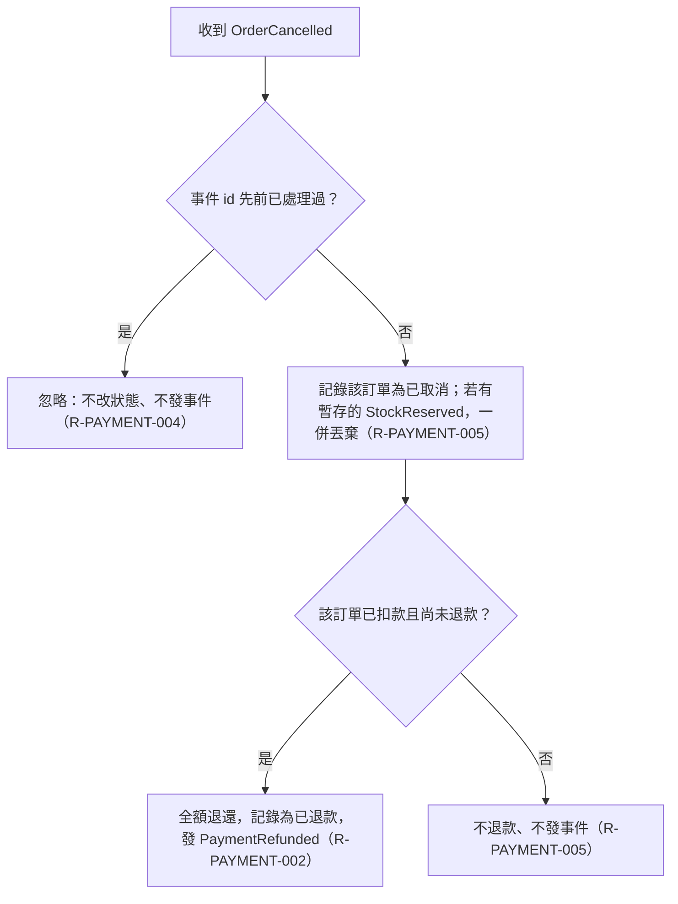

# 取消後的退款判定

涵蓋 Rule：R-PAYMENT-005、R-PAYMENT-002、R-PAYMENT-004

收到 OrderCancelled 時的判定順序：先檢查事件 id 是否重複，再記錄為已取消並丟棄暫存，最後依是否已扣款且未退款決定全額退還或不退款。

## 白話複述
1. 事件 id 處理過就忽略（R-PAYMENT-004）。
2. 記為已取消，並丟棄暫存的庫存保留（R-PAYMENT-005）。
3. 已扣款且未退款，全額退還一次，發已退款（R-PAYMENT-002）。
4. 從未扣款或已退款，不退款、不發事件（R-PAYMENT-005）。

## 已知取捨
- X-PAYMENT-001：庫存放回由庫存服務負責（範圍外）。
- X-PAYMENT-002：訂單狀態與逾時取消由訂單服務負責（範圍外）。

確認時間：2026-11-01 02:52
