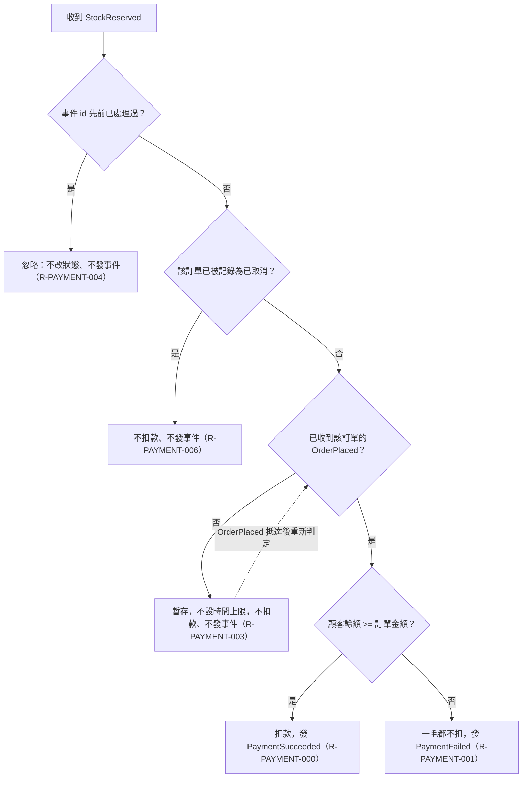

# 庫存保留後的扣款判定

涵蓋 Rule：R-PAYMENT-006、R-PAYMENT-003、R-PAYMENT-000、R-PAYMENT-001、R-PAYMENT-004

收到 StockReserved 時的判定順序：先檢查事件 id 是否重複，再檢查訂單是否已取消，最後依下單事件是否已到與餘額是否足夠決定扣款、暫存或付款失敗。

## 白話複述
1. 事件 id 處理過就忽略（R-PAYMENT-004）。
2. 訂單已被記為取消，不扣款、不發事件（R-PAYMENT-006）。
3. 下單事件還沒到，先暫存，不設時間上限（R-PAYMENT-003）。
4. 下單事件已到且餘額 >= 金額，扣款並發付款成功（R-PAYMENT-000）。
5. 下單事件已到但餘額不夠（未知顧客視為 0），一毛都不扣，發付款失敗（R-PAYMENT-001）。

## 已知取捨
- X-PAYMENT-003：付款服務不持久化，狀態只在記憶體。
- 執行者裁示 (a)：暫存不設時間上限。

確認時間：2026-11-01 02:52
