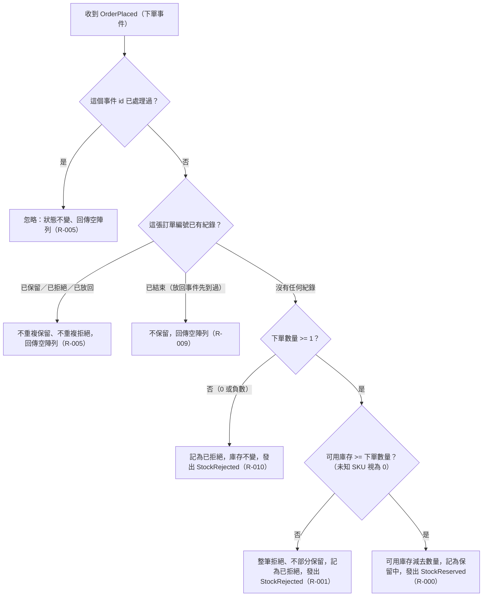

# 下單事件處理

庫存服務收到 OrderPlaced 後，先以事件 id 與訂單編號去重，再依數量合法性與可用庫存決定保留或拒絕。

## rule_id
- R-INVENTORY_RESERVATION-000
- R-INVENTORY_RESERVATION-001
- R-INVENTORY_RESERVATION-005
- R-INVENTORY_RESERVATION-009
- R-INVENTORY_RESERVATION-010

## 流程圖

## 白話複述
1. 下單事件到達，數量 >= 1、可用庫存足夠、這張訂單沒處理過 → 扣住數量、發「庫存已保留」（R-000）
2. 下單事件到達，可用庫存不夠（未知 SKU 視為 0）→ 整筆拒絕、庫存不動、發「庫存不足」（R-001）
3. 同一訂單的下單事件再來（同事件 id 重送，或同訂單不同 id）→ 不重複保留／拒絕、回空陣列、不發事件（R-005）
4. 已結束的訂單之後才收到下單事件 → 不保留、回空陣列、不發事件（R-009）
5. 下單數量 0 或負數 → 視為不合法、記為已拒絕、庫存不變、發 StockRejected（R-010）

## 已知取捨
- 訂單狀態轉換、顧客取消與逾時自動取消屬訂單服務（X-INVENTORY_RESERVATION-001）
- 事件 id 的產生方式屬實作細節，不另立規則（使用者裁示 (c)）

## 確認時間
2026-11-01 03:05
