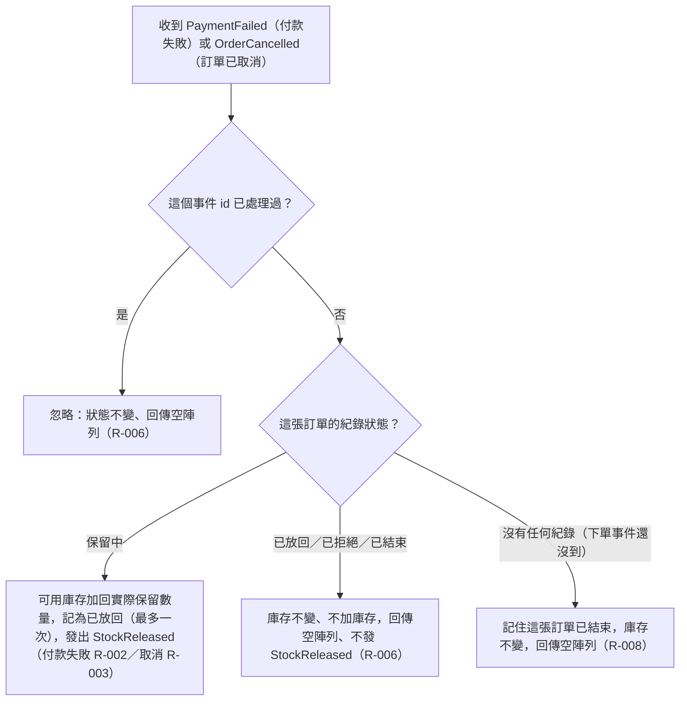

# 放回事件處理

庫存服務收到 PaymentFailed 或 OrderCancelled 後，只對「保留中」的訂單放回一次並發 StockReleased；沒有保留可放回的一律不動作；下單事件還沒到的則記住已結束。

## rule_id
- R-INVENTORY_RESERVATION-002
- R-INVENTORY_RESERVATION-003
- R-INVENTORY_RESERVATION-006
- R-INVENTORY_RESERVATION-008

## 流程圖

## 白話複述
1. 付款失敗到達，訂單保留中 → 加回實際保留數量、記為已放回、發「庫存已放回」（R-002）
2. 訂單已取消到達，訂單保留中（不分是否已付款）→ 加回實際保留數量、記為已放回、發「庫存已放回」（R-003）
3. 訂單沒有保留中的庫存（已放回、已拒絕、已結束）又收到付款失敗／訂單已取消 → 庫存不變、回空陣列、不發 StockReleased（R-006）
4. 付款失敗／訂單已取消比下單事件先到（沒有任何紀錄）→ 記住已結束、不加庫存、回空陣列（R-008）

## 已知取捨
- 扣款、退款與 Payment* 事件的發出屬付款服務（X-INVENTORY_RESERVATION-002）
- 已付款成功後取消：庫存照樣放回並發 StockReleased（使用者裁示 (a)）
- 被拒絕的訂單之後收到 OrderCancelled：不加庫存、不發 StockReleased（使用者裁示 (b)）

## 確認時間
2026-11-01 03:05
