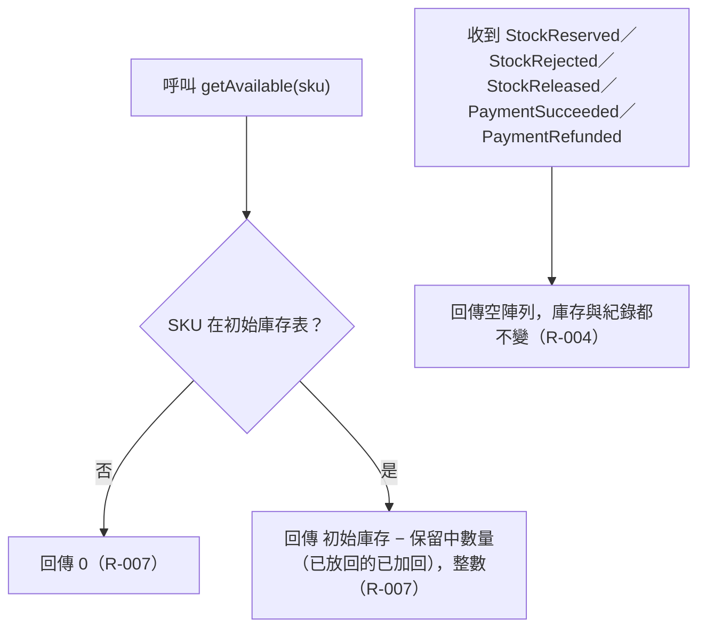

# 查詢可用庫存與不關心的事件

`getAvailable(sku)` 回傳目前可供保留的數量；庫存服務不關心的事件型別一律回傳空陣列。

## rule_id
- R-INVENTORY_RESERVATION-004
- R-INVENTORY_RESERVATION-007

## 流程圖

## 白話複述
1. 收到 StockReserved／StockRejected／StockReleased／PaymentSucceeded／PaymentRefunded → 回空陣列、什麼都不動（R-004）
2. 查可用庫存 → 初始庫存減保留中數量；未知 SKU 回 0（R-007）

## 已知取捨
- 事件匯流排的廣播、重送與整合接線屬整合人員（X-INVENTORY_RESERVATION-003）

## 確認時間
2026-11-01 03:05
