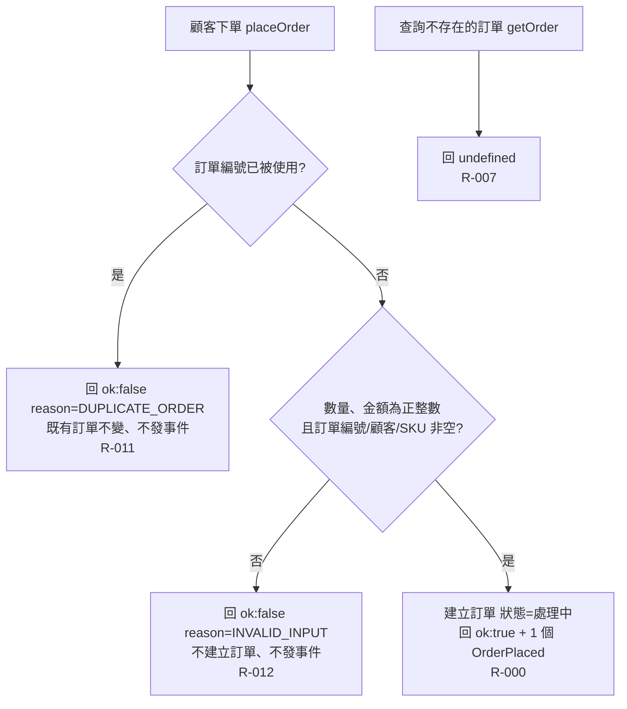

# 流程階段：下單

顧客以訂單編號、顧客、商品 SKU、數量、金額、下單時間呼叫 placeOrder；訂單服務驗證後建立「處理中」訂單並發出 OrderPlaced。另含查詢不存在訂單的行為。

- rule_id：R-ORDER_SERVICE-000、R-ORDER_SERVICE-011、R-ORDER_SERVICE-012、R-ORDER_SERVICE-007

## 白話複述
1. 顧客下單，若訂單編號沒用過、數量與金額都是 ≥1 的整數、訂單編號／顧客／SKU 都非空，就建立「處理中」訂單，回成功並恰好發一個 OrderPlaced（欄位照抄輸入、id 全系統唯一）；查詢回「處理中」（R-ORDER_SERVICE-000）
2. 用已存在的訂單編號再下單（不論該訂單目前狀態）→ 回失敗 reason=DUPLICATE_ORDER，既有訂單不變、不發事件（R-ORDER_SERVICE-011）
3. 數量或金額非正整數、或訂單編號／顧客／SKU 為空字串 → 回失敗 reason=INVALID_INPUT，不建單、不發事件（R-ORDER_SERVICE-012）
4. 查詢不存在的訂單 → undefined（R-ORDER_SERVICE-007）

## 已知取捨
- 不驗證時間字串格式（X-ORDER_SERVICE-005）
- 事件 id 採「order-」前綴加隨機 UUID，規格只要求唯一（使用者裁示 (d)）

- 確認時間：2026-11-01 03:05（需求方：確認，無不一致）
