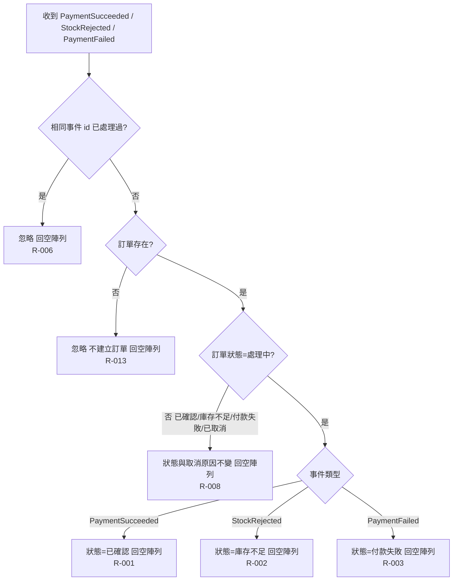

# 流程階段：收到庫存與付款結果事件

訂單服務的 handle 收到 PaymentSucceeded、StockRejected、PaymentFailed 時，依去重、訂單存在與否、目前狀態決定是否改變狀態；訂單服務不因這些事件發出任何事件。

- rule_id：R-ORDER_SERVICE-001、R-ORDER_SERVICE-002、R-ORDER_SERVICE-003、R-ORDER_SERVICE-006、R-ORDER_SERVICE-008、R-ORDER_SERVICE-013

## 白話複述
1. 處理中的訂單收到 PaymentSucceeded → 已確認，不發事件（R-ORDER_SERVICE-001）
2. 處理中的訂單收到 StockRejected → 庫存不足，不發事件（R-ORDER_SERVICE-002）
3. 處理中的訂單收到 PaymentFailed → 付款失敗，不發事件（R-ORDER_SERVICE-003）
4. 相同事件 id 再次送達 → 狀態不變、回空陣列（R-ORDER_SERVICE-006）
5. 已確認／庫存不足／付款失敗／已取消的訂單再收到任何狀態事件 → 忽略，狀態與取消原因不變，回空陣列（R-ORDER_SERVICE-008）
6. 收到的狀態事件屬於從未建立過的訂單 → 忽略，不建單、回空陣列（R-ORDER_SERVICE-013）

## 已知取捨
- 收到 OrderPlaced、StockReserved、StockReleased、PaymentRefunded、OrderCancelled 時不做任何事，回空陣列（X-ORDER_SERVICE-001）
- 庫存狀態屬庫存服務（X-ORDER_SERVICE-002）；金錢狀態屬付款服務（X-ORDER_SERVICE-003）
- 事件廣播、重送、排序由整合端負責（X-ORDER_SERVICE-004）

- 確認時間：2026-11-01 03:05（需求方：確認，無不一致）
