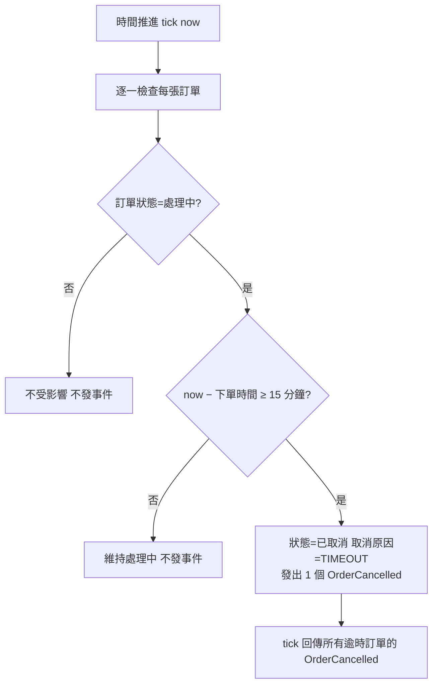

# 流程階段：逾時自動取消

整合端以 tick(now) 推進時間；訂單服務逐一檢查「處理中」訂單，下單後滿 15 分鐘者自動取消並發出 OrderCancelled。

- rule_id：R-ORDER_SERVICE-005

## 白話複述
1. 時間推進時，仍為處理中且 now − 下單時間 ≥ 15 分鐘的訂單 → 已取消（原因 TIMEOUT），每張各發一個 OrderCancelled；未滿 15 分鐘的維持處理中；其他狀態的訂單完全不受影響（R-ORDER_SERVICE-005）

## 已知取捨
- tick 只比較 now 與各訂單下單時間、不記住前次 tick；時間倒退不觸發任何變化（使用者裁示 (b)）
- 不驗證 now 的時間字串格式（X-ORDER_SERVICE-005）

- 確認時間：2026-11-01 03:05（需求方：確認，無不一致）
