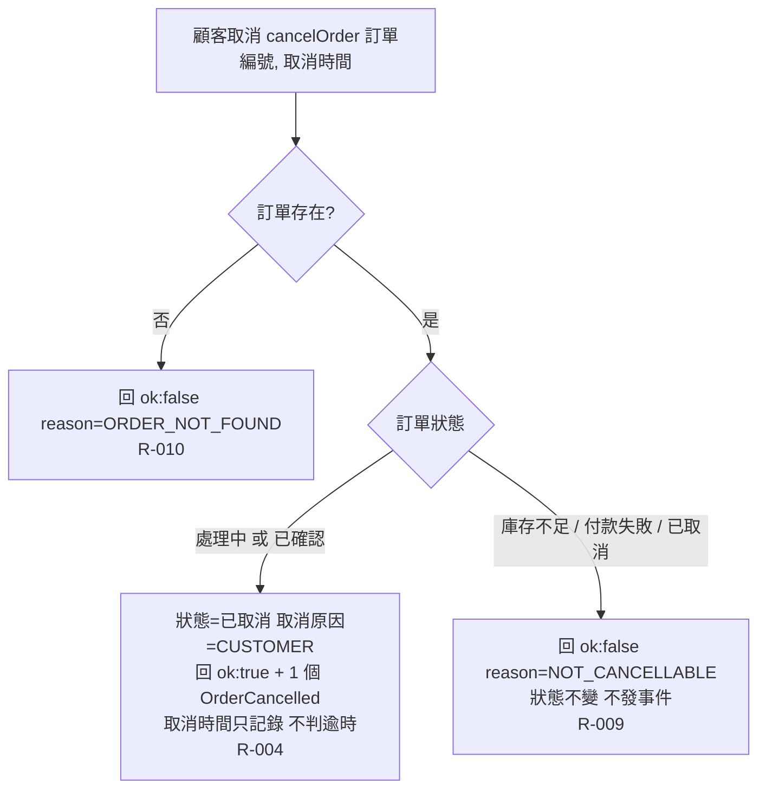

# 流程階段：顧客取消

顧客以訂單編號與取消時間呼叫 cancelOrder；訂單服務依訂單是否存在與目前狀態決定取消或拒絕。

- rule_id：R-ORDER_SERVICE-004、R-ORDER_SERVICE-009、R-ORDER_SERVICE-010

## 白話複述
1. 處理中或已確認的訂單被顧客取消 → 已取消（原因 CUSTOMER），回成功並恰好發一個 OrderCancelled；取消時間只記錄，就算已超過 15 分鐘仍算顧客取消（R-ORDER_SERVICE-004）
2. 庫存不足／付款失敗／已取消的訂單被顧客取消 → 回失敗 reason=NOT_CANCELLABLE，不變、不發事件（R-ORDER_SERVICE-009）
3. 取消不存在的訂單 → 回失敗 reason=ORDER_NOT_FOUND（R-ORDER_SERVICE-010）

## 已知取捨
- 已確認訂單被取消不需要「退款中」等中間狀態，直接 CANCELLED（使用者裁示 (c)）
- 退款與放回庫存由付款、庫存服務收到 OrderCancelled 後各自處理（X-ORDER_SERVICE-002、003）

- 確認時間：2026-11-01 03:05（需求方：確認，無不一致）
