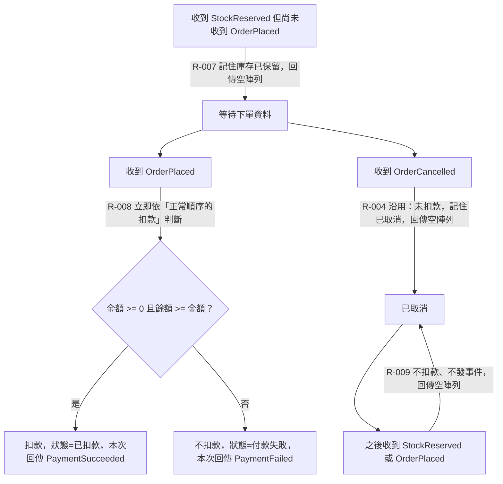

# 事件亂序

事件不保證先後順序：StockReserved 先於 OrderPlaced 到達、或 OrderCancelled 先於 StockReserved／OrderPlaced 到達時，付款服務如何保持最終一致。

## rule_id
R-PAYMENT-007, R-PAYMENT-008, R-PAYMENT-009, R-PAYMENT-004（沿用）

## 流程圖

## 白話複述
1. 庫存已保留比下單先到 → 先記住、不回應（R-PAYMENT-007）
2. 下單到達時立即判斷並在那時發付款成功／失敗（R-PAYMENT-008）
3. 從未扣款成功的訂單收到取消 → 記住已取消，不退款、不發事件（R-PAYMENT-004，沿用）
4. 已取消的訂單之後才收到庫存已保留或下單 → 一律忽略（R-PAYMENT-009）

## 已知取捨
- X-PAYMENT-001 逾時自動取消由訂單服務判定
- POLICY-001 前置事件未到先記住，到達時補做

## 確認時間
2026-11-01 03:04（第 1 次確認通過）
