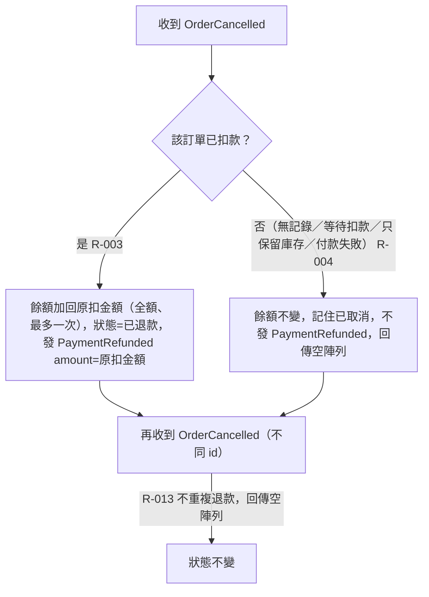

# 取消與退款

收到 OrderCancelled 時依訂單是否已扣款決定退款或只記住取消；同一張訂單最多退一次。

## rule_id
R-PAYMENT-003, R-PAYMENT-004, R-PAYMENT-013

## 流程圖

## 白話複述
1. 已扣款的訂單收到取消 → 全額退回、發已退款，一張訂單最多退一次（R-PAYMENT-003）
2. 從未扣款成功的訂單收到取消 → 記住已取消，不退款、不發事件（R-PAYMENT-004）
3. 已退款／已取消的訂單再收到取消（不同 id）→ 忽略（R-PAYMENT-013）

## 已知取捨
- X-PAYMENT-002 cancelOrder 指令與訂單狀態查詢屬訂單服務
- X-PAYMENT-001 逾時自動取消由訂單服務判定（付款服務只看到 OrderCancelled，不區分原因）

## 確認時間
2026-11-01 03:04（第 1 次確認通過）
