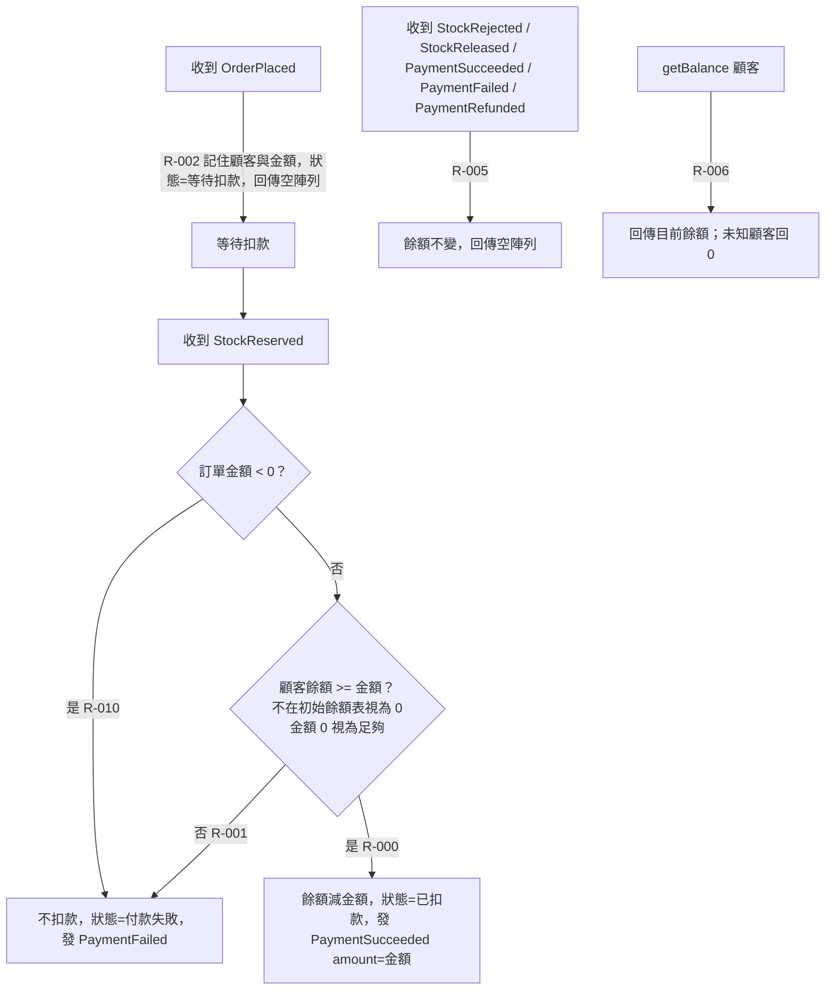

# 正常順序的扣款

事件依 OrderPlaced → StockReserved 的順序到達時，付款服務如何記錄訂單、判斷餘額並發出付款結果；另含不關心的事件與餘額查詢。

## rule_id
R-PAYMENT-002, R-PAYMENT-000, R-PAYMENT-001, R-PAYMENT-010, R-PAYMENT-005, R-PAYMENT-006

## 流程圖

## 白話複述
1. 收到下單事件，記住這張訂單是誰的、要收多少，狀態為等待扣款，不發事件（R-PAYMENT-002）
2. 等待扣款的訂單收到庫存已保留：金額 >= 0 且餘額 >= 金額（相等算夠、0 元算夠）→ 扣款、發付款成功（R-PAYMENT-000）
3. 同上但餘額不夠（未知顧客視為 0）→ 一毛不扣、發付款失敗（R-PAYMENT-001）
4. 同上但金額為負 → 視為無效，不扣款、發付款失敗（R-PAYMENT-010）
5. 不關心的事件類型 → 回傳空陣列（R-PAYMENT-005）
6. 查餘額 → 回傳目前餘額，未知顧客回 0（R-PAYMENT-006）

## 已知取捨
- X-PAYMENT-003 庫存保留與放回屬庫存服務
- X-PAYMENT-004 不檢查 OrderPlaced 的 sku／qty 等與付款無關欄位

## 確認時間
2026-11-01 03:04（第 1 次確認通過）
