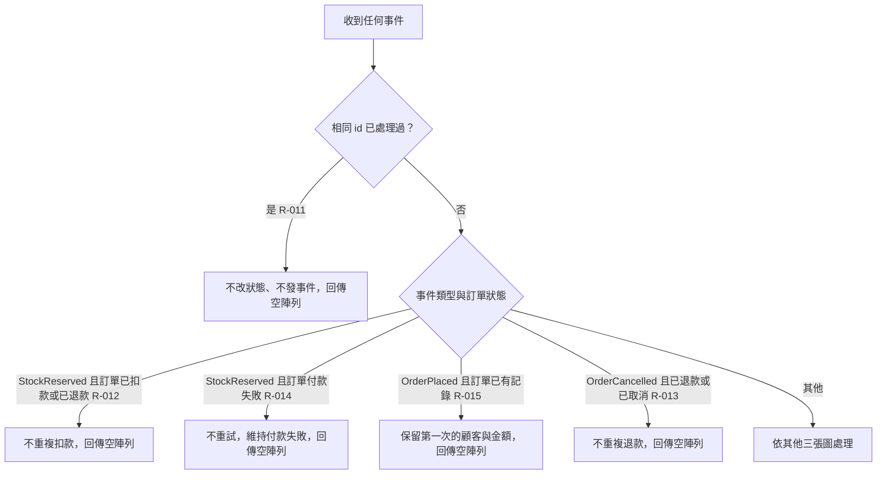

# 重複送達與冪等

事件至少送達一次、可能重複：相同 id 一律忽略；不同 id 但動作已做過的事件依訂單狀態靜默忽略。

## rule_id
R-PAYMENT-011, R-PAYMENT-012, R-PAYMENT-014, R-PAYMENT-015, R-PAYMENT-013（沿用）

## 流程圖

## 白話複述
1. 同 id 事件第二次起 → 一律忽略（R-PAYMENT-011）
2. 已扣款／已退款的訂單再收到庫存已保留（不同 id）→ 忽略（R-PAYMENT-012）
3. 已退款／已取消的訂單再收到取消（不同 id）→ 忽略（R-PAYMENT-013，沿用）
4. 付款失敗的訂單再收到庫存已保留（不同 id）→ 不重試、忽略（R-PAYMENT-014）
5. 已有記錄的訂單再收到下單（不同 id）→ 保留第一次資料、忽略（R-PAYMENT-015）

## 已知取捨
- X-PAYMENT-005 已處理事件 id 與訂單記錄永久保留、不清理
- POLICY-002 同 id 忽略；已做過的動作依狀態靜默忽略、不重發

## 確認時間
2026-11-01 03:04（第 1 次確認通過）
