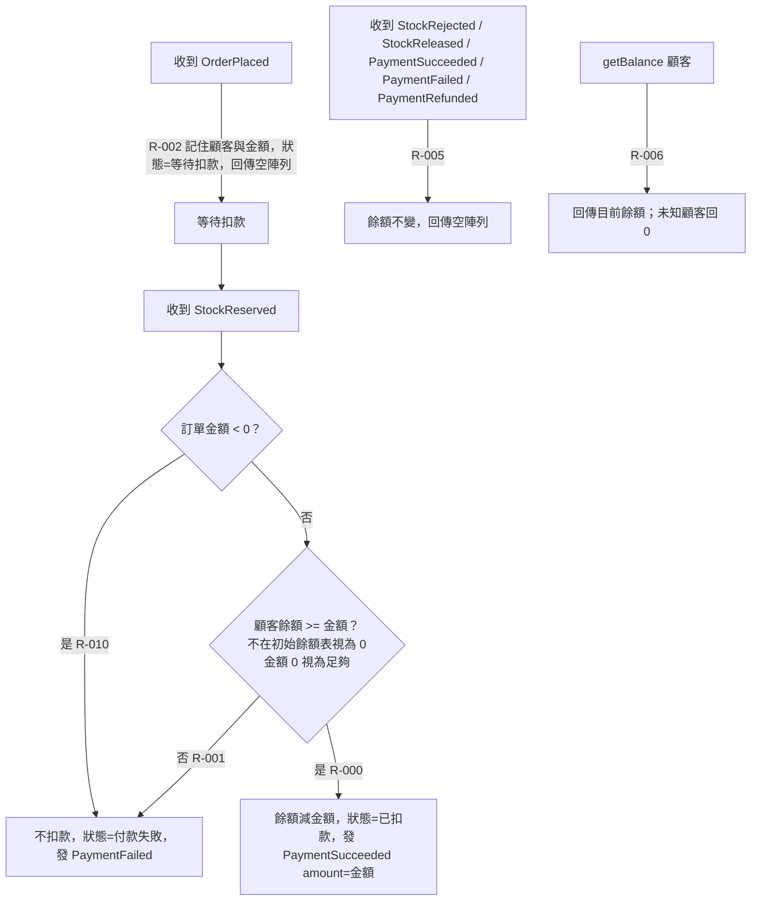
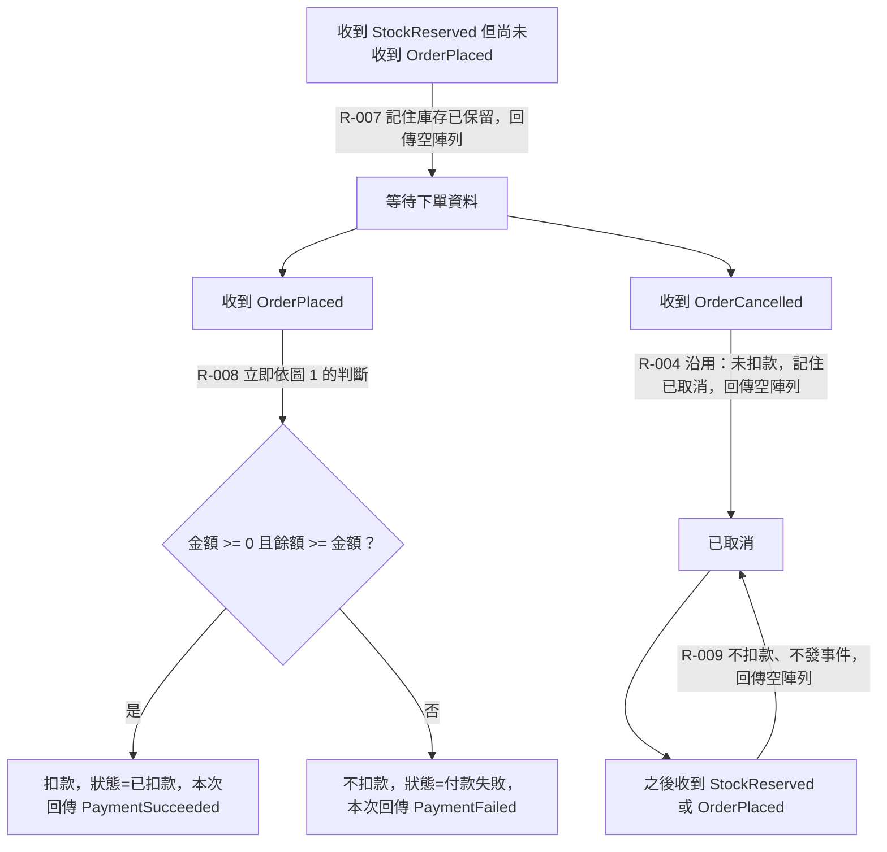
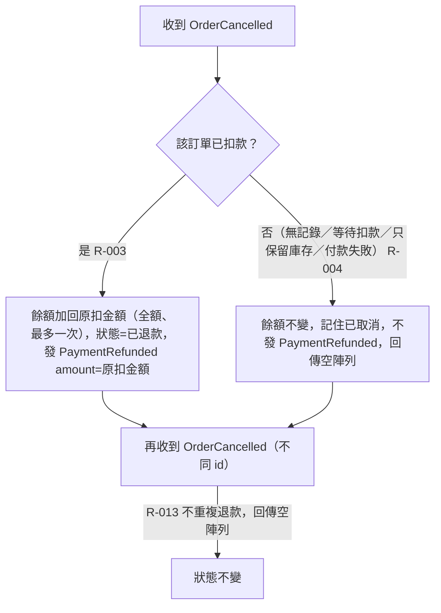
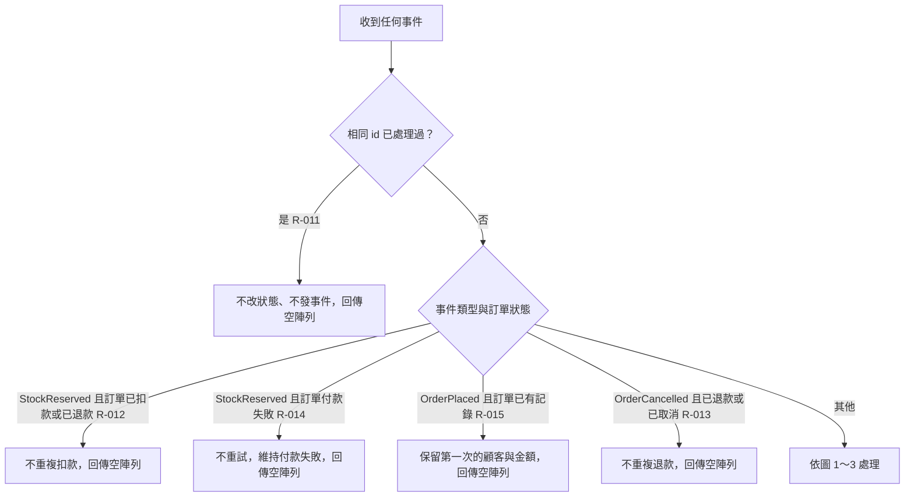

# BENCH-LOG — T4-C-tm-r1 payment（SpecEngine 2.1.0）

## 時間
- 開始：2026-11-01 02:52:05

## 階段紀錄

### spec-manifest-sync（首次導入）
- 掃描結果：node v24.18.0（本機實測，package.json 未宣告 engines）；@cucumber/cucumber 11.3.0、typescript 5.9.3、tsx 4.23.15（node_modules 實測；package.json 宣告 ^11.3.0／^5.6.3／^4.19.2）；cucumber.cjs 宣告 feature 路徑 `.specengine/spec/features/**/*.feature`、steps `tests/steps/**/*.ts`、support `tests/support/**/*.ts`、report `reports/cucumber.json`；無 assertion 套件（使用 node:assert）；無 DB／ORM／UI；`.claude/`、`CLAUDE.md`、`.specengine/` 皆不存在。
- 技術環境答案（任務預先給定，不必問）：Binding Layer = direct；Driver Directory 不適用。
- 完成彙報：

```text
[spec-manifest-sync] 執行完成！
模式：manifest 首次建立 ｜ CLAUDE.md 區塊 首次插入（v2.1.0，專案無既有 .claude/skills/ 工具，EXISTING_TOOLS_NOTE 整行移除）
核實：待核實 33 項 ｜ 已更新 30 項 ｜ 仍待確認 3 項 ｜ 必填缺口 0 項（Binding Layer 由任務預先給定 direct，其餘 4 項皆有直接證據，未另提問）
變更明細（範本〔待確認〕 → 填入值）：
  - 第 1 節「Architecture Pattern」：〔待確認〕 → 事件驅動服務拆分，本專案只實作付款服務（直接證據）
  - 第 1 節「Source Root Directory」：〔待確認〕 → `src/`（直接證據：tsconfig include、README）
  - 第 1 節「Test Root Directory」：〔待確認〕 → `tests/`（直接證據）
  - 第 1 節「Step Definitions Directory」：〔待確認〕 → `tests/steps/`（直接證據：cucumber.cjs import）
  - 第 2 節「Primary Language & Runtime」：〔待確認〕 → TypeScript 5.9.3／Node v24.18.0（本機實測，package.json 未宣告 engines）／ESM＋tsx
  - 第 2 節「Database Engine／Data Access & ORM」：〔待確認〕 → 無（直接證據：需求「不碰資料庫」、package.json 無相依）
  - 第 2 節「Schema Migration／Seed Script／UI Framework／CSS」：〔待確認〕 → 不適用／無
  - 第 3 節「Database Tables & Columns」：〔待確認〕 → 不適用，DBML 暫採 snake_case
  - 第 3 節「Backend Classes / Interfaces / Methods」：〔待確認〕 → PascalCase 型別、camelCase 函式（直接證據：src/events.ts）
  - 第 3 節「Frontend ...」：〔待確認〕 → 不適用
  - 第 3 節「Code File Names」：〔待確認〕 → 小寫單字 .ts，import 寫 .js（直接證據）
  - 第 4 節「API Interface Standard」：〔待確認〕 → 記憶體內事件介面 handle/getBalance（直接證據）
  - 第 5 節「BDD Execution Framework」：〔待確認〕 → @cucumber/cucumber 11.3.0（直接證據）
  - 第 5 節「Assertion Library」：〔待確認〕 → node:assert/strict（唯一候選）
  - 第 5 節「Test Execution Command」：〔待確認〕 → `npm test`；typecheck `npm run typecheck`（直接證據）
  - 第 5 節「Test Report Path」：〔待確認〕 → `reports/cucumber.json`（直接證據：cucumber.cjs）
  - 第 5 節「Property-Based Testing Library」：〔待確認〕 → 無（直接證據）
  - 第 5 節「Binding Layer」：〔待確認〕 → `direct`（團隊決策，任務預先給定）
  - 第 5 節「Driver Directory」：〔待確認〕 → 不適用
  - 第 5 節「Test Data Seeding Strategy／Test Double Strategy」：〔待確認〕 → 以 createPaymentService(balances) 與手工事件（唯一候選）
  - 第 5 節「Test Database Isolation／Schema Introspection」：〔待確認〕 → 不適用
  - 第 6 節「Authentication／Context Injection／Multi-Tenancy」：〔待確認〕 → 無／不適用／customerId 區分（直接證據）
仍待確認：
  - 第 3 節「Test Functions / Variables / File Names」：tests/steps/ 尚空，待程式碼進駐後核實
  - 第 3 節「Test Identifier Language」：團隊決策，未填則 spec 04 預設 en
  - 第 4 節「Error Response Format」：介面無錯誤回傳通道，屬團隊決策
未修改上述兩個目標以外的任何檔案。
```

### spec-run Step 00
- `spec-status.js --json` → exit 2（找不到 matrix）→ 起點 spec-01。

### spec-01（2026-11-01 02:54）
- feature-lint：PASS（0 句型）。spec-status：PAYMENT CLARIFYING，待答 6（High 3／Medium 2／Low 1），下一步 spec 02。

```text
[Phase 01: Discovery Bootstrap] 執行完成！模組：PAYMENT

矩陣：7 條 Rules ｜ erm.dbml：3 個 Tables ｜ terms.md：17 個術語 ｜ exclusions：3 條 ｜ 套用慣例：0 項
待答：6 題（High 3 ｜ Medium 2 ｜ Low 1）
階段：CLARIFYING
```

### spec-02 第一輪提問（2026-11-01 02:56，等待需求方回答）
- 已依定位分 2 組共 6 題，題目原文見下方「問答原文」。

## 問答原文

### 第 1 組（spec-02，2026-11-01 02:56）
====================================================================
❓ [模組：PAYMENT] [第 1～3 / 共 6 題] [定位：R-PAYMENT-000 扣款主流程的前置資料與邊界]
--------------------------------------------------------------------
Q1（High）「庫存已保留」比「下單事件」先到，付款服務當下不知道這張訂單是誰的、要扣多少，要怎麼辦？
  影響：扣款主流程與記錄下單的前置條件、訂單狀態要不要多一個「庫存已保留但還沒收到下單」、亂序測試
  [A] 先記住庫存已保留、暫不回應；等下單事件到了立刻補做扣款判斷，並在那時發出付款成功／付款失敗
  [B] 當下沒資料就直接發出付款失敗；之後下單事件到了只記錄、不補扣
  [C] 當下忽略、什麼都不記；之後下單事件到了也只記錄，等重送的「庫存已保留」再處理
  [Short] 自訂（<=5 字）
Q2（Medium）初始餘額表裡沒有的顧客下單了，他的餘額當多少？查他的餘額要回什麼？
  影響：餘額資料的建立時機、餘額不足與查詢餘額的測試
  [A] 當餘額 0：扣款會因餘額不足而付款失敗（除非金額 0）；查餘額回 0
  [B] 當資料錯誤：處理事件時拋出例外中斷；查餘額也拋出例外
  [Short] 自訂（<=5 字）
Q3（Low）訂單金額是 0 或負數（上游資料錯誤）時，收到「庫存已保留」要怎麼處理？
  影響：扣款主流程與餘額不足的前置條件、金額欄位的約束、邊界測試
  [A] 一律照數學算：金額 0 視為足夠、扣 0 元並發付款成功；負數也照算（餘額會變多）
  [B] 金額 0 照 A 處理；負數視為無效，不扣款並發付款失敗
  [C] 金額 0 與負數都視為無效，不扣款並發付款失敗
  [Short] 自訂（<=5 字）
====================================================================

### 第 2 組（spec-02，2026-11-01 02:56）
====================================================================
❓ [模組：PAYMENT] [第 4～6 / 共 6 題] [定位：已有結果的訂單再收到事件（冪等）]
--------------------------------------------------------------------
Q4（High）訂單已經扣款成功，又收到同一張訂單的「庫存已保留」；或已經退款，又收到同一張訂單的「訂單已取消」。確定不能重複扣款／退款，但要怎麼回應？
  影響：扣款與退款規則新增重複送達分支、要不要保存事件 id 去重、冪等測試
  [A] 看訂單狀態：做過就靜默忽略，回傳空陣列，餘額不變
  [B] 看訂單狀態：不再扣款／退款，但重新發一次相同結果的事件（付款成功或已退款，金額相同、事件 id 為新值），餘額不變
  [C] 只用事件 id 去重：同 id 忽略；不同 id 但同訂單的「庫存已保留」視為新要求再扣一次
  [Short] 自訂（<=5 字）
Q5（High）付款服務已先收到某張訂單的「訂單已取消」（當時還沒扣款，所以沒退款），之後才收到同一張訂單的「庫存已保留」。這張訂單已取消，要怎麼做？
  影響：取消規則要記住取消狀態、扣款主流程前置「訂單未取消」、亂序測試
  [A] 不扣款，靜默忽略，回傳空陣列
  [B] 不扣款，但發出付款失敗，讓訂單與庫存服務知道這筆沒付款
  [C] 照常扣款並發付款成功，之後若再收到取消再退款
  [Short] 自訂（<=5 字）
Q6（Medium）某張訂單曾因餘額不足發出付款失敗，之後又收到同一張訂單的「庫存已保留」（重送），此時顧客餘額可能已變多。要不要再試一次扣款？
  影響：餘額不足規則新增重複送達分支、付款失敗是否為終態、冪等測試
  [A] 不重試：忽略並回傳空陣列
  [B] 重新判斷：餘額夠了就扣款並發付款成功，仍不夠就再發一次付款失敗
  [C] 不重試，但再發一次付款失敗（事件 id 為新值）
  [Short] 自訂（<=5 字）
====================================================================
請依序回答（例如「1A 2A 3B 4A 5A 6A」或「3短:拒絕」），或輸入 'stop' 把剩餘題目掛起。

### 需求方回答（第一次喚醒 2026-11-01 02:59:20）
原文：「1「你決定，照你的最佳判斷」 2A 3「你決定，照你的最佳判斷」 4A 5A 6「你決定，照你的最佳判斷」
- Q2：未知顧客餘額視為 0；餘額不夠就發 `PaymentFailed`，一毛都不扣。
- Q4：同一個事件（同 id）第二次起直接忽略，不改任何狀態、不發任何事件。退款只在已扣款時全額退，同一張訂單最多退一次。
- Q5：付款服務記住這張訂單已取消；之後到的 `StockReserved` 不扣款、不發任何事件。
- Q6：同一個事件（同 id）重送一律忽略；其他情況你決定。」

執行者對「你決定」題的判斷（已記入各 resolved 檔）：Q1 → A（先記住、OrderPlaced 到達時補做）；Q3 → B（0 元成功、負數 PaymentFailed）；Q6 其餘情況 → A（付款失敗為終態，不重試）。

### spec-02（2026-11-01 02:59）
- feature-lint：PASS。spec-status：CLARIFIED，pending 0，next = spec flow-align（警告僅為 overview.md 快取過期，已更新）。
- 工具備註：Write 工具對本回合先前已寫過但未重新 Read 的檔案拒絕覆寫（matrix、erm.dbml、policy-defaults、兩份 overview），重新 Read 後再寫即成功；非 Skill 文件矛盾。

```text
[Phase 02: Interactive Clarify] 執行完成！模組：PAYMENT

決策：已解決 6 項 ｜ 掛起 0 項 ｜ 晉升慣例 2 項
寫回：matrix（+9 新增／6 修改）｜ exclusions（+0）｜ erm.dbml（新增 processed_event 表；payment_order.status 新增 AWAITING_ORDER、customer_balance.balance／payment_order.amount 註記異動）｜ terms.md（+0 術語、+0 文案）
階段：CLARIFIED ｜ 下一步：spec flow-align（16 條 Rule，超過小模組門檻）
```

### spec-flow-align 第 1 次確認（2026-11-01 03:03，等待需求方回答）
題目原文：

====================================================================
🗺️ [模組：PAYMENT] 流程圖對齊確認（第 1 次）
====================================================================

**圖 1：正常順序的扣款（rule_id：R-002, R-000, R-001, R-010, R-005, R-006）**


**圖 2：事件亂序（rule_id：R-007, R-008, R-009, R-004 沿用）**


**圖 3：取消與退款（rule_id：R-003, R-004, R-013）**


**圖 4：重複送達與冪等（rule_id：R-011, R-012, R-014, R-015；R-013 沿用）**


白話複述：
  1. 收到下單事件，記住這張訂單是誰的、要收多少，狀態為等待扣款，不發事件（R-PAYMENT-002）
  2. 等待扣款的訂單收到庫存已保留：金額 >= 0 且餘額 >= 金額（相等算夠、0 元算夠）→ 扣款、發付款成功（R-PAYMENT-000）
  3. 同上但餘額不夠（未知顧客視為 0）→ 一毛不扣、發付款失敗（R-PAYMENT-001）
  4. 同上但金額為負 → 視為無效，不扣款、發付款失敗（R-PAYMENT-010）
  5. 已扣款的訂單收到取消 → 全額退回、發已退款，一張訂單最多退一次（R-PAYMENT-003）
  6. 從未扣款成功的訂單收到取消 → 記住已取消，不退款、不發事件（R-PAYMENT-004）
  7. 不關心的事件類型 → 回傳空陣列（R-PAYMENT-005）
  8. 查餘額 → 回傳目前餘額，未知顧客回 0（R-PAYMENT-006）
  9. 庫存已保留比下單先到 → 先記住、不回應（R-PAYMENT-007）；下單到達時立即判斷並在那時發付款成功／失敗（R-PAYMENT-008）
  10. 已取消的訂單之後才收到庫存已保留或下單 → 一律忽略（R-PAYMENT-009）
  11. 同 id 事件第二次起 → 一律忽略（R-PAYMENT-011）
  12. 已扣款／已退款的訂單再收到庫存已保留（不同 id）→ 忽略（R-PAYMENT-012）
  13. 已退款／已取消的訂單再收到取消（不同 id）→ 忽略（R-PAYMENT-013）
  14. 付款失敗的訂單再收到庫存已保留（不同 id）→ 不重試、忽略（R-PAYMENT-014）
  15. 已有記錄的訂單再收到下單（不同 id）→ 保留第一次資料、忽略（R-PAYMENT-015）

已知取捨（exclusions.md 本模組條目）：
  - 15 分鐘逾時自動取消由訂單服務判定，付款服務不計時（X-PAYMENT-001）
  - cancelOrder 指令與訂單狀態查詢屬訂單服務（X-PAYMENT-002）
  - 庫存保留與放回屬庫存服務（X-PAYMENT-003）

執行者疑似缺口（矩陣與 exclusions 都沒有，請裁示是缺口還是範圍外）：
  (a) 付款服務收到 OrderPlaced 只記 customerId 與 amount，不檢查 sku／qty 等與付款無關的欄位
  (b) 已處理事件 id 與訂單記錄永久保留在記憶體，不做清理（測試規模下無影響）
--------------------------------------------------------------------
請確認：
  (1) 有沒有遺漏的分支、使用者行為或畫面狀態？（含上列疑似缺口的裁示）
  (2) 圖上有沒有跟你原本設想不一致的地方？
沒問題請回覆「確認」；有缺口請直接描述。
====================================================================

### 需求方回答（第二次喚醒 2026-11-01 03:03:59）
原文：「(1) (a)、(b) 你決定，照你的最佳判斷；沒有其他遺漏。(2) 沒有不一致，確認。」
執行者裁示：(a)、(b) 皆為非缺口，記入 exclusions X-PAYMENT-004、X-PAYMENT-005（類型：系統無動作）。

### spec-flow-align（2026-11-01 03:04）
- spec-status：flowAligned = true，next = spec 03。

```text
✅ [Phase Flow-Align] 執行完成！模組：PAYMENT
涵蓋 Rule：16 條 ｜ 流程階段：4 個 ｜ 已知取捨：5 條 ｜ 本輪新增範圍外裁示：2 條（X-PAYMENT-004、005，使用者授權執行者裁示）
產出：flow-design/PAYMENT.md（已通過）＋ flow-design/PAYMENT/*.md ×4
```

### spec-03（2026-11-01 03:06）
- feature-lint：PASS，12 個不重複句型，矩陣 16 條 Rule 與 @rule: tag 一一對應。

```text
[Phase 03: Formalize Gherkin] 執行完成！模組：PAYMENT
產出：.specengine/spec/features/付款服務.feature
指標：Rule 16 條 ｜ Scenario/Outline 27 個（展開 37）｜ 句型 12 個（沿用 0 個，索引原為空）｜ PARKED 註解 0 個
Examples 核對：37 列，修正 0 列 ｜ feature-lint → PASS
階段：FORMALIZED
```

### spec-04（2026-11-01 03:08）
- cucumber `--dry-run --format snippets`：12 個未定義句型，與 steps-index.json 一致。
- typecheck PASS；spec-guard snapshot：`.specengine/spec/` 5 檔全字節凍結、tests/steps/ 1 檔 12 句型、Binding Layer direct 略過 Driver。
- spec-status：STUBBED，next = spec 05。
- 工具備註：spec-guard 解析 manifest「Step Definitions Directory」時把同一行證據註記裡的第二個反引號片段（cucumber.cjs 的 import 陣列字串）也當成路徑（該行沒有「，」可截斷），輸出「tests/steps/、import: [...]」；該假路徑不存在故未影響結果，已把 manifest 該行改為只含一個反引號路徑並以「，」隔開說明。

```text
[Phase 04: Generate Test Stub] 執行完成！模組：PAYMENT

1. 框架：@cucumber/cucumber 11.3.0（已安裝）；Binding Layer：direct
2. 產出：
   - tests/steps/payment.steps.ts（Step 12 個，全部拋 Contract Not Implemented）
   - Driver 介面／實作：無（direct 模式略過）
   - tests/support/world.ts（新建；cucumber.cjs 的 import 已涵蓋 tests/support/**/*.ts）
3. 對齊 DBML 欄位 11 個，100% Red Stage（37 scenarios / 37 failed，Contract Not Implemented）
4. 模組階段狀態：STUBBED（已寫回 .specengine/sdd/overview.md）
```

### spec-05 Step 1（2026-11-01 03:08）
- snapshot 已建立；`npm test` 基準：37 scenarios (37 failed)，211 steps (37 failed, 174 skipped)，全部為 Contract Not Implemented。

### spec-05（2026-11-01 03:11）
- 實作 src/payment.ts、tests/support/world.ts（World 輔助）、tests/steps/payment.steps.ts 函式體（句型未動）。
- typecheck PASS；`npm test`：37 scenarios (37 passed)，211 steps (211 passed)，第一次跑即全綠，無形式化錯誤、無規格瑕疵。
- spec-guard verify → PASS；lock → .specengine/sdd/locks/PAYMENT.lock.json（＋ _shared.json）；feature-lint PASS；spec-status：IMPLEMENTED（已完工）。
- Property-Based Testing Library 未宣告，略過 property test；Binding Layer direct，無第二 Driver。

```text
[Phase 05: Coder Implement] 執行完成！模組：PAYMENT
測試（in-process）：Scenario 37 ｜ PASS 37 ｜ FAIL 0 ｜ 測試（ui|api）：未執行（Binding Layer 為 direct，無第二 Driver）
形式化錯誤自修：0 件 ｜ snapshot 重建：0 次
產品代碼：src/payment.ts ｜ Driver 實作：無（direct；測試輔助 tests/support/world.ts、tests/steps/payment.steps.ts 函式體）
verify → PASS ｜ lock → .specengine/sdd/locks/PAYMENT.lock.json
階段：IMPLEMENTED
```

### spec-run 彙整

```text
[spec-run] 執行完成！模組：PAYMENT

起點：spec-01（spec-status 推導：exit 2，尚無矩陣），起點之前階段無

1. spec-01  → 完成
2. spec-02  → 完成（已解決 6、掛起 0）
3. flow-align → 完成（第 1 次確認通過）
4. spec-03  → 完成（lint PASS）
5. spec-04  → 完成
6. spec-05  → 完成（全綠，verify PASS，lock 已建）

階段：IMPLEMENTED
```

## 工具錯誤與 Skill 文件矛盾
- 無阻斷性工具錯誤。
- spec-guard 的 manifest 路徑解析會把「Step Definitions Directory」同一行內所有反引號片段（直到第一個「，」）當成路徑；初版 manifest 的證據註記含第二個反引號片段而被誤認為路徑（不存在，未影響結果），已修正 manifest 行格式。
- Write 工具對本回合先前寫過但未重新 Read 的檔案拒絕覆寫，需先 Read 再寫；屬執行環境行為，非 Skill 矛盾。
- spec-02 Skill 規定「不得代答」，但需求方對 Q1、Q3、Q6（部分）與 flow-align 疑似缺口 (a)(b) 明確回覆「你決定，照你的最佳判斷」；視為需求方親自授權執行者裁量，各決策與理由均記在 resolved 檔與 flow-design 索引。

## 時間
- 結束：2026-11-01 03:11:24
