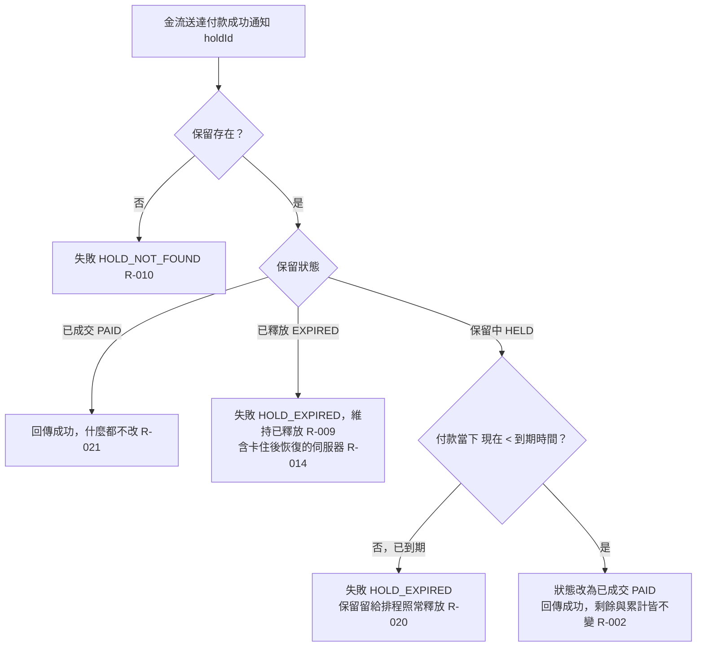

# 付款通知

金流送達付款成功通知後，依保留狀態與到期時間決定成交或拒絕；重複通知冪等。

- rule_id：R-FLASH_SALE-002、009、010、014、020、021

## 白話複述
1. 到期前收到付款通知 → 已成交，回成功，剩餘與累計不動；搶購期間是否已結束不影響。（R-002）
2. 已釋放的保留收到付款 → HOLD_EXPIRED，維持已釋放。（R-009）
3. 不存在的保留編號 → HOLD_NOT_FOUND。（R-010）
4. 伺服器處理付款卡住、期間被排程釋放，恢復後不成交（HOLD_EXPIRED），已還回件數不收回。（R-014）
5. 保留中但付款當下已到期（含剛好到期）、排程未釋放 → HOLD_EXPIRED，之後由排程照常釋放。（R-020）
6. 已成交再收到通知 → 回成功，什麼都不改。（R-021）

## 已知取捨
- 搶購結束只影響搶，不影響付款（裁示 (c)）

- 確認時間：2026-11-02 02:40
