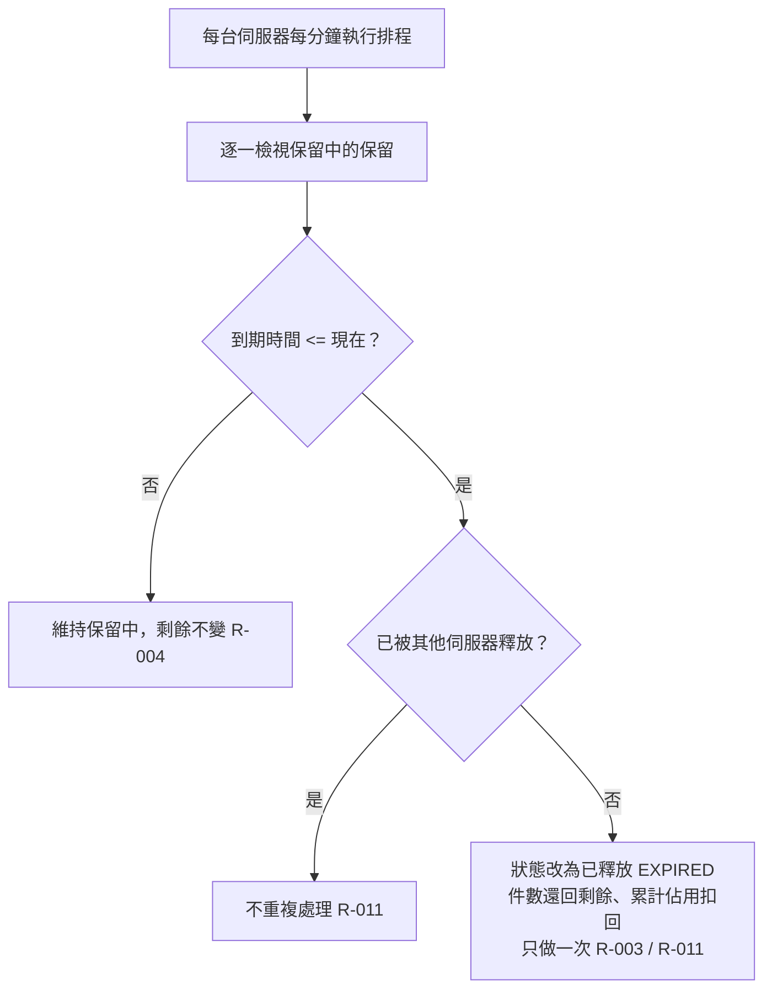

# 排程釋放

每台伺服器每分鐘執行一次，釋放到期未付款的保留；多台同時執行只釋放一次。

- rule_id：R-FLASH_SALE-003、004、011

## 白話複述
1. 保留中且到期時間 <= 現在 → 已釋放，件數還回剩餘，累計佔用扣回。（R-003）
2. 還沒到期 → 什麼都不做。（R-004）
3. 多台各自跑，同一保留只釋放一次、件數只還一次、累計只扣一次。（R-011）

## 已知取捨
- 無

- 確認時間：2026-11-02 02:40
