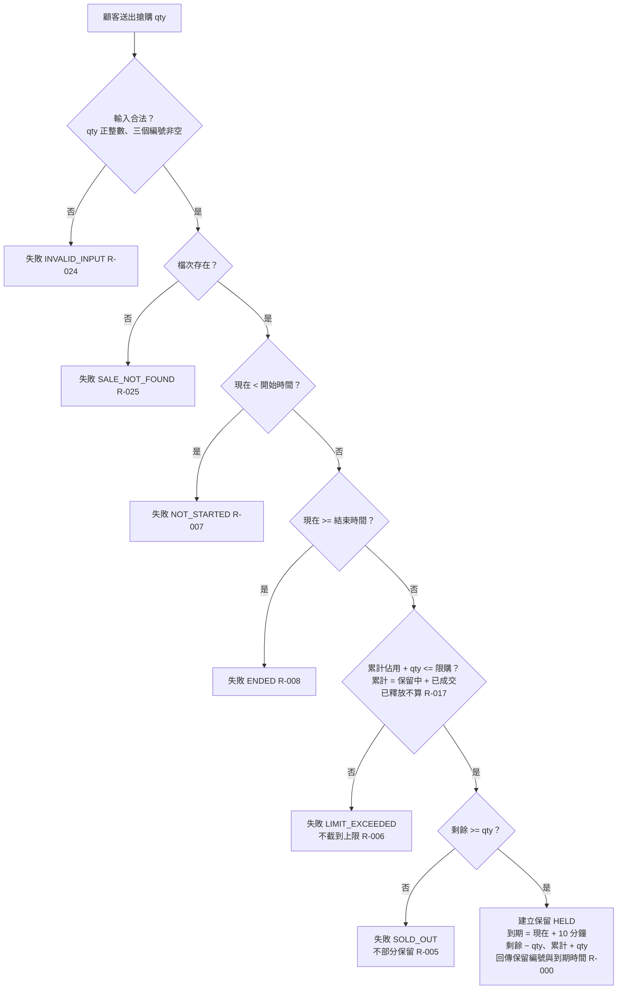

# 搶購請求

顧客在搶購期間送出搶購，依序驗證輸入、檔次、期間、限購、剩餘，成功則建立保留。

- rule_id：R-FLASH_SALE-000、005、006、007、008、017、024、025

## 白話複述
1. 搶購期間（開始時刻含、結束時刻不含）、輸入合法、剩餘夠、限購沒超（剛好等於可以）→ 建保留中、10 分鐘到期、回保留編號與到期時間、剩餘減 qty、累計加 qty。（R-000）
2. 剩餘 < qty（含 0）→ SOLD_OUT，不部分保留。（R-005）
3. 累計 + qty > 限購 → LIMIT_EXCEEDED，不截到上限。（R-006）
4. 現在 < 開始時間 → NOT_STARTED。（R-007）
5. 現在 >= 結束時間 → ENDED。（R-008）
6. 先前保留到期被釋放後額度還回，可再搶。（R-017）
7. qty 非正整數或三個編號任一為空 → INVALID_INPUT。（R-024）
8. 檔次不存在 → SALE_NOT_FOUND。（R-025）

## 已知取捨
- 扣件後寫保留前當機遺失的件數不回收（X-FLASH_SALE-001）
- 卡住後恢復、期間已結束才完成的保留視為合法（裁示 (d)）

- 確認時間：2026-11-02 02:40
