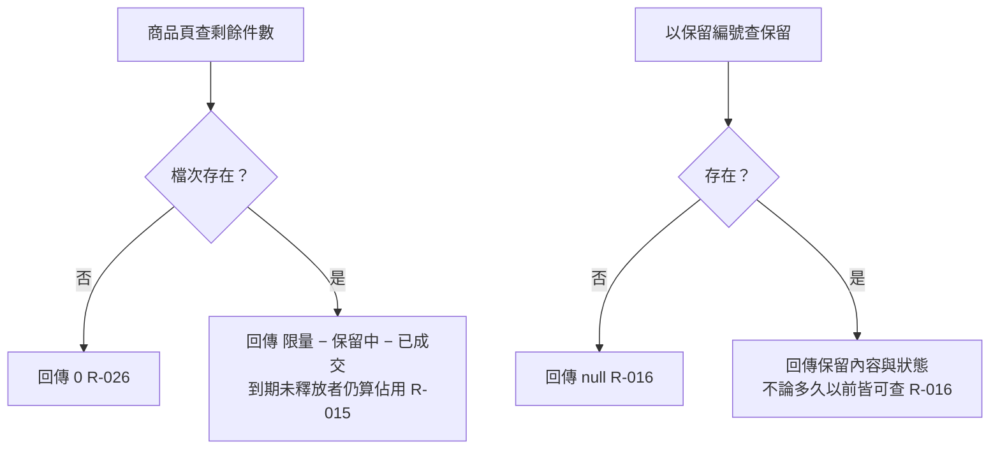

# 查詢

商品頁查剩餘可搶件數；以保留編號查保留。

- rule_id：R-FLASH_SALE-015、016、026

## 白話複述
1. 剩餘 = 限量 − 保留中 − 已成交；到期但排程未釋放仍算佔用。（R-015）
2. 查保留：存在回內容與狀態（永久可查），不存在回 null。（R-016）
3. 查不存在檔次的剩餘 → 0。（R-026）

## 已知取捨
- 保留與請求紀錄永久保存（X-FLASH_SALE-002）

- 確認時間：2026-11-02 02:40
