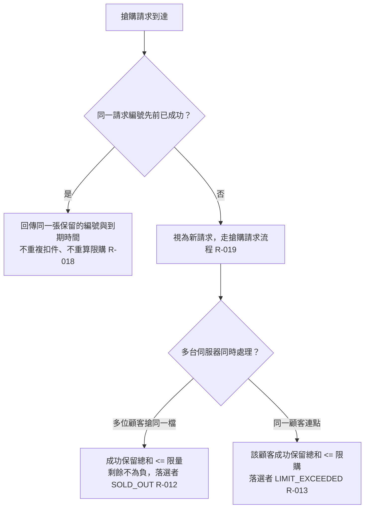

# 重送與多機併發

同一請求編號的重送處理，以及多台伺服器同時處理搶購時的不超賣、不超限購。

- rule_id：R-FLASH_SALE-012、013、018、019

## 白話複述
1. 多位顧客多台伺服器同時搶，成功總和 <= 限量，剩餘不為負，搶不到的回 SOLD_OUT。（R-012）
2. 同一顧客連點（不同請求編號）多台同時處理，成功總和 <= 限購，超的回 LIMIT_EXCEEDED。（R-013）
3. 同一請求編號重送，前次成功 → 回同一張保留，不重複扣件、不重算限購。（R-018）
4. 同一請求編號重送，前次失敗 → 當成新請求重新判斷。（R-019）

## 已知取捨
- 重送內容與第一次不同時仍以請求編號為準回放（裁示 (a)）

- 確認時間：2026-11-02 02:40
