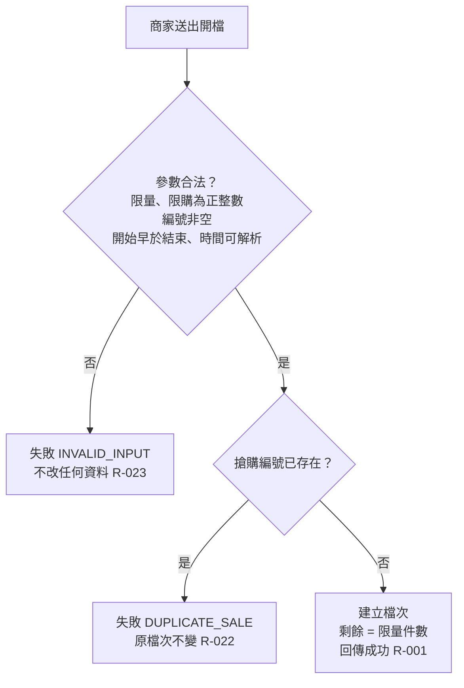

# 開檔

商家開一檔限量搶購：參數驗證、編號重複檢查、建立檔次。

- rule_id：R-FLASH_SALE-001、R-FLASH_SALE-022、R-FLASH_SALE-023

## 白話複述
1. 參數合法且編號未用過就建立檔次，剩餘 = 限量。限購大於限量不擋。（R-001）
2. 同一搶購編號再開檔 → 失敗 DUPLICATE_SALE，原檔次不變。（R-022）
3. 開檔參數不合法（限量或限購非正整數、編號為空、開始不早於結束、時間無法解析）→ 失敗 INVALID_INPUT。（R-023）

## 已知取捨
- 開檔不檢查限購是否大於限量（X-FLASH_SALE-003）
- 允許開一檔結束時間已早於現在的搶購（裁示 (b)）

- 確認時間：2026-11-02 02:40
