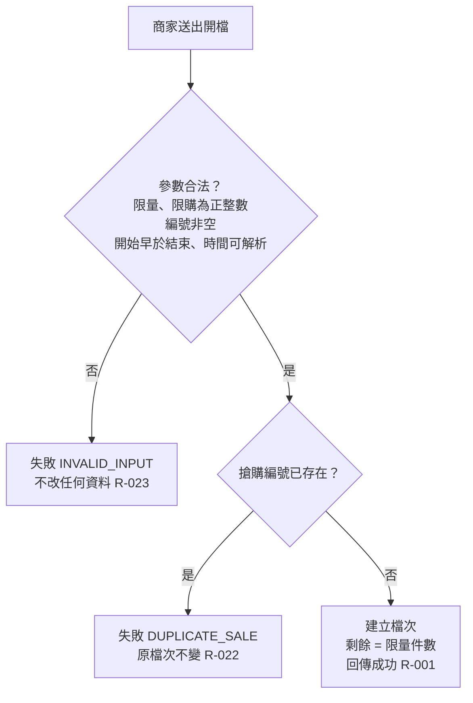
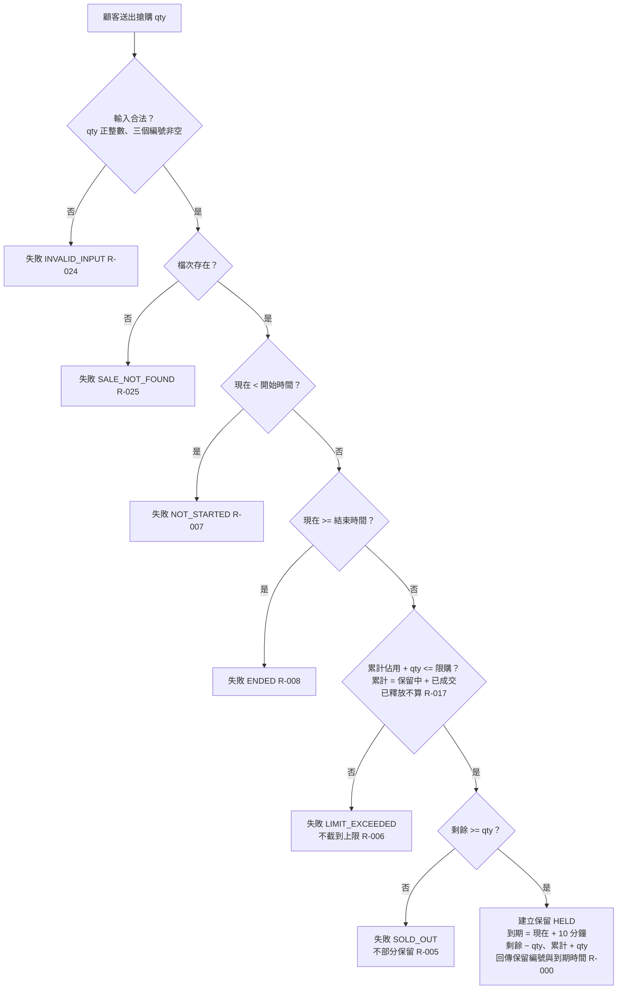
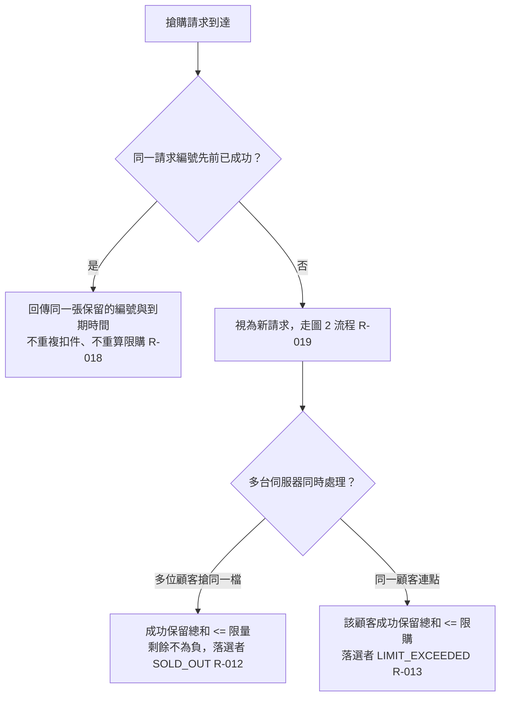
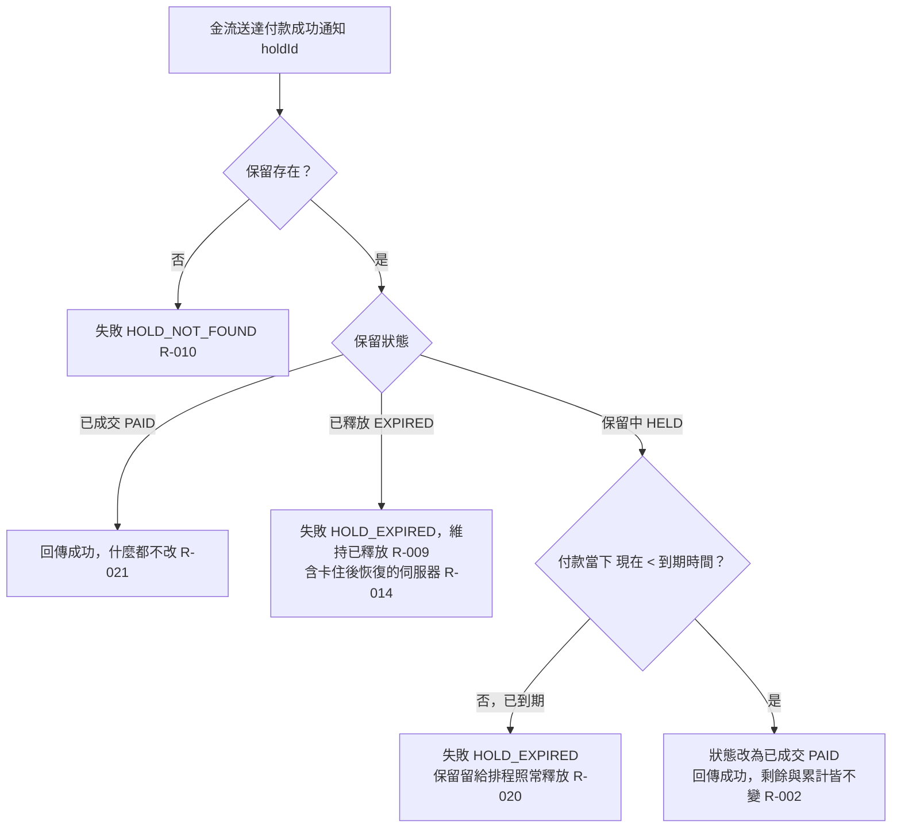
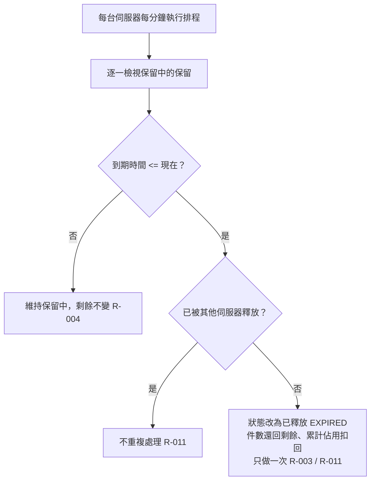
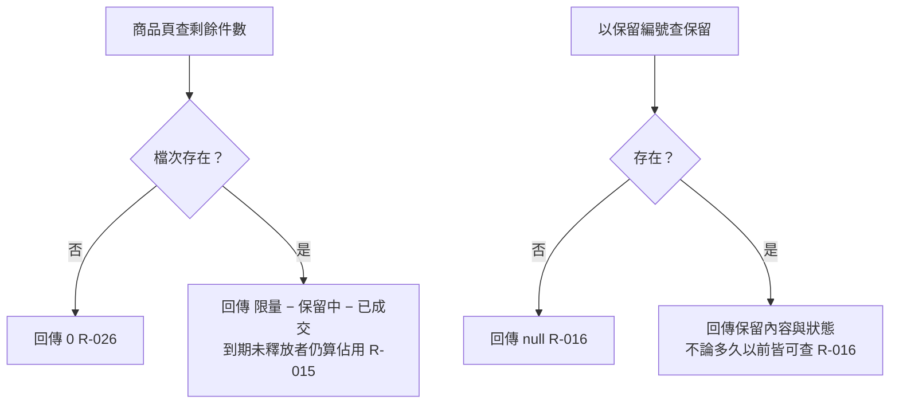

# BENCH-LOG：T5-C-r1（SpecEngine 2.1.0 全流程）

- 開始時間：2026-11-02 01:18:43
- 專案：bench-points（TypeScript + cucumber-js 11.3.0，Node v24.18.0）
- 需求：限量搶購（tasks/t5/requirement.md）
- 技術環境答案（需求方預先提供）：Binding Layer = direct，Driver Directory 不適用

## 時間軸

| 時間 | 事件 |
| :--- | :--- |
| 2026-11-02 01:18:43 | 開始；讀取需求、plugin skills、contract-rules、scripts |

## 階段紀錄

### (a) spec-manifest-sync（首次導入）— 2026-11-02 01:18～02:26

```text
[spec-manifest-sync] 執行完成！
模式：manifest 首次建立 ｜ CLAUDE.md 區塊 首次插入（v2.1.0）
核實：待核實 29 項 ｜ 已更新 19 項 ｜ 仍待確認 10 項 ｜ 必填缺口 0 項（Binding Layer 由需求方預先指定 direct，未另問）
變更明細（全部由範本〔待確認〕→ 填入）：
  - 第 1 節「Architecture Pattern」：〔待確認〕 → 單一 Node 套件、純函式庫（唯一候選）
  - 第 1 節「Source Root Directory」：〔待確認〕 → `src/`（直接證據：README、tsconfig）
  - 第 1 節「Test Root Directory」：〔待確認〕 → `tests/`（直接證據：README、cucumber.cjs）
  - 第 1 節「Step Definitions Directory」：〔待確認〕 → `tests/steps/`（直接證據：cucumber.cjs import）
  - 第 2 節「Primary Language & Runtime」：〔待確認〕 → TypeScript ^5.6.3（安裝 5.9.3）、ESM NodeNext、Node v24.18.0（本機實測）、tsx
  - 第 2 節「Database Engine／ORM／Migration／Seed／UI／CSS」：〔待確認〕 → 無（直接證據：package.json）
  - 第 3 節「Frontend ...」：〔待確認〕 → 不適用（無前端）
  - 第 3 節「Code File Names」：〔待確認〕 → 小寫英文（唯一候選：src/index.ts）
  - 第 5 節「BDD Execution Framework」：〔待確認〕 → `@cucumber/cucumber` ^11.3.0（直接證據）
  - 第 5 節「Assertion Library」：〔待確認〕 → `node:assert/strict`（唯一候選）
  - 第 5 節「Test Execution Command」：〔待確認〕 → `npm test`（直接證據）
  - 第 5 節「Test Report Path」：〔待確認〕 → `reports/cucumber.json`（直接證據：cucumber.cjs）
  - 第 5 節「Property-Based Testing Library」：〔待確認〕 → 無（直接證據）
  - 第 5 節「Binding Layer」：〔待確認〕 → `direct`（團隊決策，需求方指定）
  - 第 5 節「Driver Directory」：〔待確認〕 → 不適用
仍待確認：
  - 第 3 節「Database Tables & Columns」「Backend ...」「Test Functions ...」「Test Identifier Language」：無樣本／團隊決策（spec 04 預設 en）
  - 第 4 節兩項、第 5 節「Test Data Seeding Strategy」「Test Database Isolation」「Test Double Strategy」「Schema Introspection Command」、第 6 節三項：團隊決策或無證據
未修改上述兩個目標以外的任何檔案。
```

工具輸出：無錯誤。

### (b) spec-run — Step 00 起點判定

- 2026-11-02 02:26:40 `spec-status.js --json` → exit 2（找不到 matrix/）→ 起點 spec-01。

### spec-01 Discovery Bootstrap — 2026-11-02 02:26

```text
[Phase 01: Discovery Bootstrap] 執行完成！模組：FLASH_SALE

矩陣：17 條 Rules ｜ erm.dbml：4 個 Tables ｜ terms.md：26 個術語 ｜ exclusions：0 條 ｜ 套用慣例：0 項
待答：13 題（High 7 ｜ Medium 5 ｜ Low 1）
階段：CLARIFYING
```

- feature-lint → PASS（0 違規；句型索引 0 個）
- spec-status → FLASH_SALE | CLARIFYING | 13（Low 1 / Medium 5 / High 7）| 下一步 spec 02

### spec-02 Interactive Clarify — 第 1 輪提問（13 題，5 組一次列出）

（題目原文見下方「問答原文」；等待需求方回答）

## 問答原文

### spec-02 第 1 輪（2026-11-02 02:30 送出）

====================================================================
❓ [模組：FLASH_SALE] [第 1～4 / 共 13 題] [定位：搶購請求 R-FLASH_SALE-000／005／006（grab）]
--------------------------------------------------------------------
Q1（High）顧客要的件數比剩餘可搶件數多（剩 2 件卻要 3 件），怎麼辦？
  影響：剩餘件數、保留件數、搶購成功／失敗判定與所有「剩餘不足」測試
  [A] 整筆拒絕，不建立保留，剩餘不變  [B] 部分成交，只保留剩下的 2 件並回成功  [Short] 自訂（<=5 字）
Q2（High）這次件數加上先前已佔用會超過限購（限購 3、已佔 2、再要 2），怎麼辦？
  影響：累計佔用件數、保留件數、搶購成功／失敗判定
  [A] 整筆拒絕  [B] 截到上限，只保留還能買的 1 件並回成功  [Short] 自訂（<=5 字）
Q3（High）限購額度怎麼累計？搶到沒付款、到期被釋放的件數還算不算在額度裡？（限購 2：搶 2 件沒付、釋放後能不能再搶 2 件？）
  影響：累計佔用件數的增減時機、排程釋放時的副作用、限購相關測試
  [A] 只算「保留中」＋「已成交」，釋放後額度還回來可再搶  [B] 曾搶到就算，含已釋放，額度不還回  [Short] 自訂（<=5 字）
Q4（High）同一個搶購請求因網路逾時重送（請求編號相同），第二次要回什麼？
  影響：請求紀錄、搶購回傳值、重送測試
  [A] 冪等回放：第一次成功就回同一個保留編號與到期時間；第一次失敗則重送時重新評估  [B] 拒絕第二次，告知重複請求  [C] 完整回放：不論成敗一律回第一次的結果  [Short] 自訂（<=5 字）
====================================================================
❓ [模組：FLASH_SALE] [第 5～7 / 共 13 題] [定位：付款與到期 R-FLASH_SALE-002／003／007／008（pay、sweep）]
--------------------------------------------------------------------
Q5（High）保留已到期、但排程還沒跑到釋放（最多約一分鐘空窗），此時付款成功通知到了，要不要成交？
  影響：付款前置判定、保留狀態轉換、到期付款測試
  [A] 拒絕，視同已到期（10 分鐘是硬期限，已付款由金流退款、不在本系統）  [B] 仍成交，只要排程還沒釋放就算數  [Short] 自訂（<=5 字）
Q6（High）保留已成交後，同一筆付款通知又送來一次，回成功還是失敗？
  影響：付款回傳值、重複通知測試
  [A] 回成功（冪等，狀態不變）  [B] 回失敗（已付款）  [Short] 自訂（<=5 字）
Q7（Medium）時間剛好等於邊界時刻算哪邊？(1) 剛好等於開始時間能否搶 (2) 剛好等於結束時間能否搶 (3) 剛好等於到期時間算不算已到期
  影響：搶購期間判定、付款到期判定、排程釋放判定、所有時間邊界 Examples
  [A] 半開區間：開始時刻可搶、結束時刻不可搶；到期時刻即視為已到期（現在 >= 到期就不能付款、排程會釋放）  [B] 全部包含：開始與結束時刻都可搶；到期時刻當下仍可付款，排程只釋放「現在 > 到期」者  [Short] 自訂（<=5 字）
====================================================================
❓ [模組：FLASH_SALE] [第 8 / 共 13 題] [定位：多機與故障 R-FLASH_SALE-012（remaining）]
--------------------------------------------------------------------
Q8（High）伺服器已在共用儲存扣掉剩餘件數、還沒寫入保留紀錄就當機不再回來。這些件數沒有保留指向、排程找不到可釋放的東西。以現有 Store 的原子操作，無法同時保證「絕不超賣」與「這類件數一定能回收」，必須二選一。
  影響：搶購的寫入順序、排程掃描範圍、當機情境測試
  [A] 寧可少賣、絕不超賣：這類件數視為遺失不回收；任何時候成功保留總和不超過限量  [B] 必須回收：到期後由排程加回，但極端情況可能多加回而超賣  [Short] 自訂（<=5 字）
====================================================================
❓ [模組：FLASH_SALE] [第 9～11 / 共 13 題] [定位：開檔與輸入驗證 R-FLASH_SALE-001／000／015（openSale、grab、getRemaining）]
--------------------------------------------------------------------
Q9（Medium）商家用已存在的搶購編號再開一檔，怎麼辦？
  影響：開檔回傳值、檔次寫入策略
  [A] 拒絕，原檔次不變  [B] 覆寫，剩餘重設為新限量（既有保留如何處理需另釐清）  [Short] 自訂（<=5 字）
Q10（Medium）開檔參數不合理（限量 <= 0、限購 <= 0、限購 > 限量、結束不晚於開始、件數非整數、時間非合法 ISO 8601），怎麼辦？
  影響：開檔前置驗證、檔次欄位約束、開檔參數邊界 Examples
  [A] 一律拒絕、不建立檔次  [B] 限購 > 限量時自動截為限量並成功，其餘拒絕  [C] 不檢查，照單全收  [Short] 自訂（<=5 字）
Q11（Medium）顧客搶購輸入不合理：(1) 搶購件數 <= 0 或非整數 (2) 檔次不存在。另外商品頁查「不存在的檔次」剩餘件數要顯示什麼？
  影響：搶購前置驗證、剩餘查詢對不存在檔次的回傳
  [A] 兩種情況都回失敗、不建立保留；不存在檔次的剩餘回 0  [B] 兩種情況都回失敗；不存在檔次的剩餘查詢拋例外  [Short] 自訂（<=5 字）
====================================================================
❓ [模組：FLASH_SALE] [第 12～13 / 共 13 題] [定位：資料與文案 Result.reason、holds 生命週期]
--------------------------------------------------------------------
Q12（Medium）操作失敗時回傳的「原因」字串用什麼格式？（已知失敗情境：檔次不存在、未開始、已結束、售完、超過限購、件數不合法、保留不存在、保留已到期／已釋放、保留已成交、搶購編號重複、開檔參數不合法）
  影響：所有失敗回傳、terms.md 固定文案、所有失敗 Scenario 的 Then
  [A] 英文大寫代碼：SALE_NOT_FOUND、SALE_NOT_STARTED、SALE_ENDED、SOLD_OUT、LIMIT_EXCEEDED、INVALID_QTY、HOLD_NOT_FOUND、HOLD_EXPIRED、ALREADY_PAID、SALE_EXISTS、INVALID_SALE  [B] 繁體中文短句：「找不到搶購檔次」「搶購尚未開始」「搶購已結束」「已售完」「超過限購件數」「件數不合法」「找不到保留」「保留已到期」「保留已成交」「搶購編號重複」「開檔參數不合法」  [Short] 自訂（<=5 字）
Q13（Low）保留紀錄（含已成交、已釋放）與請求編號紀錄保存多久？
  影響：保留與請求紀錄寫入是否帶存活期限、久遠之後查詢保留的回傳
  [A] 永久保存，任何時候都查得到（清理不在本模組）  [B] 搶購結束後一段時間（例如 24 小時）自動清除，之後查詢回 null  [Short] 自訂（<=5 字）
====================================================================
請依序回答（例如「1A 2A 3A 4A 5A 6A 7A 8A 9A 10A 11A 12A 13A」或「12短:中文」），或輸入 'stop' 把剩餘題目掛起。

### 需求方回覆（喚醒時間 2026-11-02 02:32:31）

Q1: A。剛好等於可以搶到。不夠就整筆拒絕，回 `SOLD_OUT`，不部分保留。
Q2: A。超過就整筆拒絕，回 `LIMIT_EXCEEDED`。
Q3: A。保留中與已成交都算；已到期釋放的不算（釋放後可以再搶）。
Q4: A。前一次成功：回同一張保留（同 holdId、同到期時間），不重複佔名額、不重算限購。前一次失敗：當成新請求重新判斷。
Q5: A。以付款當下時間判斷：到期時刻（含）之後一律拒絕，回 `HOLD_EXPIRED`，即使排程還沒釋放；這張保留之後由排程照常釋放。
Q6: A。已成交的保留再收到通知：回成功、不改任何東西。已釋放的回 `HOLD_EXPIRED`。找不到回 `HOLD_NOT_FOUND`。
Q7: A。開始時刻（含）起可搶，結束時刻（含）起不可搶。現在時間 ≥ 到期時間就算到期（剛好 10 分鐘算到期），排程釋放後狀態為 `EXPIRED`，件數加回剩餘。
Q8: 你決定，照你的最佳判斷。
Q9: A。saleId 已存在 → `DUPLICATE_SALE`，不改任何資料。
Q10: quantity 或 perCustomerLimit 不是正整數、saleId 為空、開始時間不早於結束時間 → `INVALID_INPUT`，不改任何資料。限購大於限量、時間格式不合法：你決定，照你的最佳判斷。
Q11: 搶購時 qty 不是正整數，或 saleId／customerId／requestId 為空字串 → `INVALID_INPUT`；搶購編號不存在 → `SALE_NOT_FOUND`，都不改任何資料。不存在檔次的剩餘查詢：你決定，照你的最佳判斷。
Q12（自填）：英文大寫代碼：`SOLD_OUT`、`LIMIT_EXCEEDED`、`NOT_STARTED`、`ENDED`、`INVALID_INPUT`（開檔與搶購共用）、`SALE_NOT_FOUND`、`DUPLICATE_SALE`、`HOLD_EXPIRED`、`HOLD_NOT_FOUND`。重複付款通知不是失敗（回成功）。其他情境你決定。
Q13: 你決定，照你的最佳判斷。

執行者受授權後的決定（已記入 resolved 檔）：Q8 → A（不回收，寧少賣不超賣，exclusions X-001）；Q10 限購>限量 → 允許開檔（X-003），時間格式不合法 → INVALID_INPUT；Q11 不存在檔次剩餘 → 回 0；Q13 → 永久保存（X-002）。

## 階段紀錄（續）

### spec-02 完成彙報 — 2026-11-02 02:32

```text
[Phase 02: Interactive Clarify] 執行完成！模組：FLASH_SALE

決策：已解決 13 項 ｜ 掛起 0 項 ｜ 晉升慣例 9 項（POLICY-001～009）
寫回：matrix（+10 新增 R-017～026／M 修改 R-000、001、002、003、005、006、007、008、009、010、012、013、014、016）｜ exclusions（+3）｜ erm.dbml（9 欄 note 異動）｜ terms.md（+1 術語、+9 文案）
階段：CLARIFIED ｜ 下一步：spec flow-align（27 條 Rule 超過小模組門檻）
```

- feature-lint → PASS；spec-status → CLARIFIED, pending 0, flowAligned false, next `spec flow-align`
- 工具備註：Edit／Write 工具在被喚醒後要求先 Read 才可改寫先前自己建立的檔案（對話狀態重置），改以 Node 腳本（scratchpad/resolve-mcq.cjs）追加決策並搬移 13 個 MCQ 至 resolved/；其餘以 Read 後 Write 完成。非 Skill 文件矛盾。

### spec-flow-align — 第 1 次提問（2026-11-02 02:40 送出）

（流程圖與白話複述原文見下方「問答原文（續）」；等待需求方確認）

## 問答原文（續）

### spec-flow-align 第 1 次（2026-11-02 02:40 送出）

====================================================================
🗺️ [模組：FLASH_SALE] 流程圖對齊確認（第 1 次）
====================================================================

**圖 1：開檔（rule_id：R-001, R-022, R-023）**


**圖 2：搶購請求（rule_id：R-000, R-005, R-006, R-007, R-008, R-017, R-024, R-025）**


**圖 3：重送與多機併發（rule_id：R-012, R-013, R-018, R-019）**


**圖 4：付款通知（rule_id：R-002, R-009, R-010, R-014, R-020, R-021）**


**圖 5：排程釋放（rule_id：R-003, R-004, R-011）**


**圖 6：查詢（rule_id：R-015, R-016, R-026）**


白話複述：
  1. 顧客在搶購期間（開始時刻含、結束時刻不含）送出合法的搶購，剩餘夠、限購沒超（剛好等於都算可以），系統建一張「保留中」的保留，10 分鐘後到期，回傳保留編號與到期時間，剩餘減 qty、該顧客累計佔用加 qty。（R-000）
  2. 商家開檔：參數合法且編號未用過，就建立檔次，剩餘 = 限量。限購大於限量不擋。（R-001）
  3. 到期前收到付款通知，保留轉「已成交」，回成功，剩餘與累計都不動。（R-002）
  4. 排程看到「保留中」且「到期時間 <= 現在」的保留，改成「已釋放」，件數還回剩餘，該顧客累計佔用扣回。（R-003）
  5. 排程看到還沒到期的保留，什麼都不做。（R-004）
  6. 剩餘 < qty（含 0）→ 失敗 SOLD_OUT，不部分保留。（R-005）
  7. 累計 + qty > 限購 → 失敗 LIMIT_EXCEEDED，不截到上限。（R-006）
  8. 現在 < 開始時間 → 失敗 NOT_STARTED。（R-007）
  9. 現在 >= 結束時間 → 失敗 ENDED。（R-008）
  10. 已釋放的保留收到付款通知 → 失敗 HOLD_EXPIRED，維持已釋放。（R-009）
  11. 不存在的保留編號收到付款通知 → 失敗 HOLD_NOT_FOUND。（R-010）
  12. 多台伺服器各自跑排程，同一保留只釋放一次、件數只還一次、累計只扣一次。（R-011）
  13. 多位顧客多台伺服器同時搶同一檔，成功保留總和 <= 限量，剩餘不為負，搶不到的回 SOLD_OUT。（R-012）
  14. 同一顧客連點（不同請求編號）在多台伺服器同時處理，成功總和 <= 限購，超的回 LIMIT_EXCEEDED。（R-013）
  15. 伺服器處理付款卡住，期間保留被排程釋放，恢復後付款不成交（HOLD_EXPIRED），已還回的件數不會被收回。（R-014）
  16. 商品頁剩餘 = 限量 − 保留中 − 已成交；到期但排程還沒釋放的保留仍算佔用。（R-015）
  17. 以保留編號查保留：存在就回內容與狀態（永久可查），不存在回 null。（R-016）
  18. 顧客先前的保留到期被釋放後，額度還回來，可以再搶。（R-017）
  19. 同一請求編號重送，前一次成功 → 回同一張保留（同編號、同到期），不重複扣件、不重算限購。（R-018）
  20. 同一請求編號重送，前一次失敗 → 當成新請求重新判斷。（R-019）
  21. 保留中但付款當下已到期（含剛好到期時刻）、排程還沒釋放 → 失敗 HOLD_EXPIRED，之後由排程照常釋放。（R-020）
  22. 已成交的保留再收到付款通知 → 回成功，什麼都不改。（R-021）
  23. 同一搶購編號再開檔 → 失敗 DUPLICATE_SALE，原檔次不變。（R-022）
  24. 開檔參數不合法（限量或限購非正整數、編號為空、開始不早於結束、時間無法解析）→ 失敗 INVALID_INPUT。（R-023）
  25. 搶購輸入不合法（qty 非正整數、三個編號任一為空）→ 失敗 INVALID_INPUT。（R-024）
  26. 搶購不存在的檔次 → 失敗 SALE_NOT_FOUND。（R-025）
  27. 查不存在檔次的剩餘 → 回 0。（R-026）

已知取捨（exclusions.md 本模組條目）：
  - 伺服器扣件後、寫入保留前當機所遺失的件數，系統不回收（寧少賣不超賣）（X-FLASH_SALE-001）
  - 保留與請求紀錄永久保存，不自動清除（X-FLASH_SALE-002）
  - 開檔不檢查限購是否大於限量，照常開檔（X-FLASH_SALE-003）

執行者疑似缺口（矩陣與 exclusions 都沒有、但我認為可能需要的，請裁示是缺口還是範圍外）：
  (a) 同一請求編號重送，但內容與第一次不同（例如 qty 或顧客不同）。目前矩陣只看請求編號回放第一次結果，不比對內容。
  (b) 商家開一檔「結束時間已早於現在」的搶購。目前矩陣允許開檔（之後所有搶購都回 ENDED）。
  (c) 搶購期間已結束、但顧客手上還有未到期的保留，此時付款通知到達。目前矩陣（R-002）不看搶購期間，只看保留是否到期 → 仍成交。
  (d) 伺服器在搶購期間內通過了期間檢查後卡住，恢復時搶購期間已結束，才完成扣件與寫入保留。目前矩陣未定義；實作上仍守住不超賣、不超限購，但會多出一張「期間外建立」的保留。
--------------------------------------------------------------------
請確認：
  (1) 有沒有遺漏的分支、使用者行為或畫面狀態？（含上列疑似缺口 (a)～(d) 的裁示）
  (2) 圖上有沒有跟你原本設想不一致的地方？
沒問題請回覆「確認」；有缺口請直接描述。
====================================================================

### 需求方回覆 flow-align（喚醒時間 2026-11-02 02:40:54）

(a) 你決定，照你的最佳判斷。
(b) 你決定，照你的最佳判斷。
(c) 可以付款成交。搶購結束只影響搶，不影響付款。
(d) 你決定，照你的最佳判斷。
(1)(2) 其餘確認。

執行者受授權後的裁示（已寫入 flow-design/FLASH_SALE.md「使用者已裁示非缺口」）：(a) 非缺口，以請求編號為準回放；(b) 非缺口，允許開檔；(c) 依需求方：非缺口，R-002 不檢查搶購期間；(d) 非缺口，守住不超賣與不超限購即視為合法保留。四項皆未新增 Rule，矩陣未動。

## 階段紀錄（續 2）

### spec-flow-align 完成彙報 — 2026-11-02 02:40

```text
✅ [Phase Flow-Align] 執行完成！模組：FLASH_SALE
涵蓋 Rule：27 條 ｜ 流程階段：6 個 ｜ 已知取捨：3 條 ｜ 本輪新增範圍外裁示：0 條（4 項疑似缺口皆裁示為非缺口，記入索引）
產出：flow-design/FLASH_SALE.md（已通過）＋ flow-design/FLASH_SALE/*.md ×6
```

- spec-status → CLARIFIED，flowAligned ✓，next `spec 03`

### spec-03 Formalize Gherkin — 2026-11-02 02:45

```text
[Phase 03: Formalize Gherkin] 執行完成！模組：FLASH_SALE
產出：.specengine/spec/features/限量搶購.feature
指標：Rule 27 條 ｜ Scenario/Outline 31 個（展開 47）｜ 句型 24 個（沿用 0 個，索引原為空）｜ PARKED 註解 0 個
Examples 核對：19 列，修正 0 列 ｜ feature-lint → PASS
階段：FORMALIZED
```

- feature-lint → PASS（24 個不重複句型寫入 steps-index.json）
- spec-status → FORMALIZED（overview 快取 CLARIFIED 不符警告，為預期快取過期）

### spec-04 Generate Test Stub — 2026-11-02 02:47

```text
[Phase 04: Generate Test Stub] 執行完成！模組：FLASH_SALE

1. 框架：@cucumber/cucumber 11.3.0（已安裝）；Binding Layer：direct
2. 產出：
   - tests/steps/flash-sale.steps.ts（Step 24 個，全部拋 Contract Not Implemented）
   - tests/support/world.ts（World：測試時鐘、共用 MemoryStore、多台伺服器、保留別名）
   - tests/support/memory-store.ts（記憶體 Store 測試替身 ＋ StallingStore 卡住模擬）
   - src/flash-types.ts（需求固定的技術介面型別，供 World 與 Step 引用）
   - Driver 層：不適用（direct）
3. 對齊 DBML 欄位 15 個，100% Red Stage（47 scenarios / 47 failed，皆為 Contract Not Implemented）
4. 模組階段狀態：STUBBED（已寫回 .specengine/sdd/overview.md）
```

- cucumber `--dry-run --format snippets` 取得 24 個未定義句型後轉寫
- spec-guard snapshot → 成功：.specengine/spec/ 5 檔、tests/steps/ 1 檔 24 句型、direct 略過 Driver
- 工具備註：snapshot 輸出的目錄清單顯示為「tests/steps/、import: ['tests/steps/**/*.ts', ...]、tests/steps/」，因 manifest 該行的證據註解含反引號且在第一個「，」之前，被 spec-guard／spec-status 當成多個路徑。已把 manifest 該行改為「`tests/steps/`【必填】，直接證據：…」（僅改註解寫法，路徑不變）；之後 verify PASS。建議 Skill 文件提醒證據註解放在「，」之後。
- tsc --noEmit PASS

### spec-05 Coder Implement — 2026-11-02 02:47～02:50

```text
[Phase 05: Coder Implement] 執行完成！模組：FLASH_SALE
測試（in-process）：Scenario 47 ｜ PASS 47 ｜ FAIL 0 ｜ 測試（ui|api）：未執行（Binding Layer 為 direct，無第二 Driver）
形式化錯誤自修：0 件 ｜ snapshot 重建：0 次
產品代碼：src/flash.ts、src/flash-types.ts ｜ Driver 實作：不適用（direct；Step 函式體直接呼叫 createFlashSale）
verify → PASS ｜ lock → .specengine/sdd/locks/FLASH_SALE.lock.json
階段：IMPLEMENTED
```

- 紅燈基準：47/47 failed（Contract Not Implemented）→ 實作後 47/47 passed，連跑 5 次皆綠（含 R-012／R-013 併發與 R-014 卡住情境）
- Property-Based Testing Library 未宣告 → 略過 property test
- 實作要點：限購與剩餘以 incrBy 原子扣減、不足即退回；先扣件再寫保留（X-001）；保留最終狀態以 claim key set nx 認領（PAID／EXPIRED 只有一個贏家），釋放以 released key set nx 保證只還回一次；請求編號於成功後 set nx 登記，輸掉者撤銷自己並回放對方
- spec-guard verify → PASS；lock → feature 1、Step 檔 1、Driver 0；feature-lint → PASS
- spec-status → IMPLEMENTED，next（已完工）

### spec-run 總覽

```text
[spec-run] 執行完成！模組：FLASH_SALE

起點：spec-01（spec-status 推導：exit 2，無任何矩陣），起點之前階段無

1. spec-01  → 完成
2. spec-02  → 完成（已解決 13、掛起 0）
3. flow-align → 完成（4 項疑似缺口皆裁示非缺口）
4. spec-03  → 完成（lint PASS）
5. spec-04  → 完成
6. spec-05  → 完成（全綠，verify PASS，lock 已建）

階段：IMPLEMENTED
```

## 工具錯誤與 Skill 文件矛盾彙整

1. Edit／Write 工具在每次被喚醒後遺失「已讀取」狀態，改寫自己先前建立的檔案需先 Read；MCQ 歸檔改用 Node 腳本一次處理。屬執行環境限制，非 Skill 問題。
2. spec-guard／spec-status 解析 manifest 路徑欄位時，把「，」之前所有反引號片段都當路徑；manifest 範本未提醒證據註解的寫法，首次 snapshot 顯示 3 個「目錄」（實際只有 1 個存在）。已修 manifest 註解寫法；建議 spec-manifest-sync 文件補充。
3. spec-run SKILL.md 第 3 行描述「含 spec-01、spec-02 之間的 spec-flow-align 強制關卡」（應為 spec-02 與 spec-03 之間），與其 Step 2b 及 spec-flow-align 文件不一致；僅文字瑕疵，依 Step 2b 執行。
4. spec-04 在 direct 模式下需要讓 World 與 Step 引用需求固定的介面型別，為避免紅燈階段 import 不存在的 src/flash.ts，先建立 src/flash-types.ts；Skill 文件對 direct 模式的型別來源沒有說明，屬文件空白。

- 結束時間：2026-11-02 02:52（commit 前）
