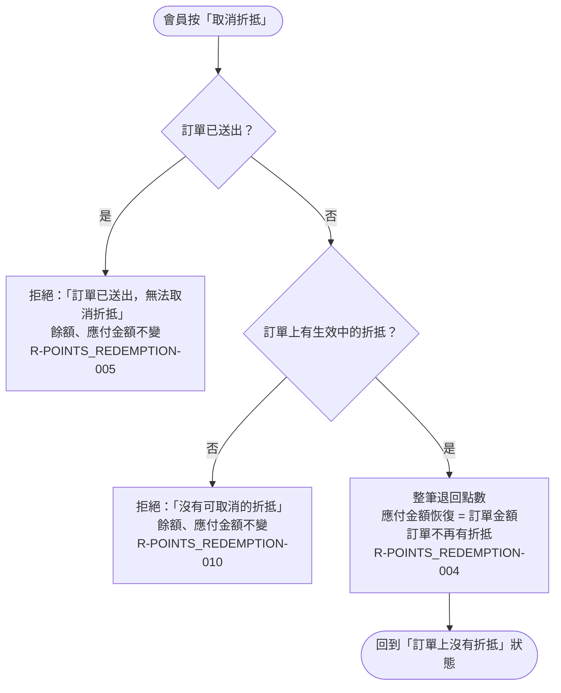

# 取消折抵

會員在未送出訂單上整筆取消折抵：已送出拒絕、無折抵拒絕，否則退點、應付金額恢復、訂單不再有折抵。

涵蓋 rule_id：R-POINTS_REDEMPTION-004、R-POINTS_REDEMPTION-005、R-POINTS_REDEMPTION-010

## 白話複述

1. 訂單還沒送出、上面有折抵，會員按取消 → 整筆退點，應付金額回到訂單金額，訂單上不再有折抵。不能只取消一部分。（R-POINTS_REDEMPTION-004）
2. 訂單已送出後按取消 → 拒絕，訊息「訂單已送出，無法取消折抵」。（R-POINTS_REDEMPTION-005）
3. 訂單上沒有折抵卻按取消 → 拒絕，訊息「沒有可取消的折抵」。（R-POINTS_REDEMPTION-010）

## 已知取捨

- 會員折抵後離開、逾時或訂單被清掉，系統不自動退點；點數維持扣除，直到會員回來取消或送出訂單。（R-POINTS_REDEMPTION-009）
- 不留點數異動歷史／流水表。（POLICY-007，資料層決策）

> 確認時間：2026-10-18 01:45
