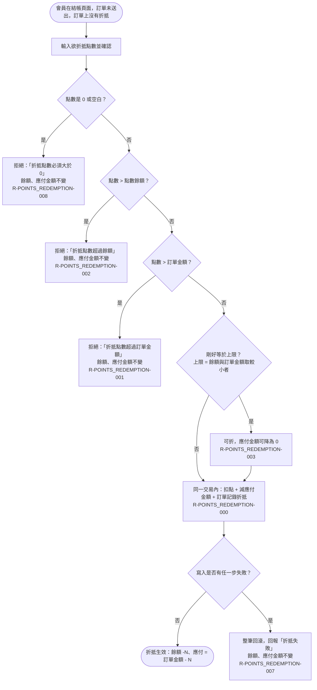

# 折抵驗證與成交

會員在未送出、尚無折抵的訂單上首次折抵：零值、餘額、訂單金額三道檢查，等於上限可折，扣點與減價在同一交易內完成，寫入失敗整筆回滾。

涵蓋 rule_id：R-POINTS_REDEMPTION-000、R-POINTS_REDEMPTION-001、R-POINTS_REDEMPTION-002、R-POINTS_REDEMPTION-003、R-POINTS_REDEMPTION-007、R-POINTS_REDEMPTION-008

## 白話複述

1. 會員在結帳頁、訂單還沒送出、訂單上還沒有折抵時，輸入點數並確認：點數不超過餘額也不超過訂單金額，就在同一個資料庫交易裡扣點、減應付金額、把折抵點數記在訂單上。（R-POINTS_REDEMPTION-000）
2. 點數沒超過餘額、但超過訂單金額 → 拒絕，訊息「折抵點數超過訂單金額」，什麼都不變。（R-POINTS_REDEMPTION-001）
3. 點數超過餘額（不管有沒有同時超過訂單金額）→ 拒絕，訊息「折抵點數超過餘額」，什麼都不變。兩者都超過時以餘額訊息為準。（R-POINTS_REDEMPTION-002）
4. 點數剛好等於上限（可用餘額或訂單金額取較小者）→ 可以折，應付金額可以降到 0。（R-POINTS_REDEMPTION-003）
5. 扣點或減價任一步寫入失敗 → 整筆回滾，回報「折抵失敗」，什麼都不變。（R-POINTS_REDEMPTION-007）
6. 輸入 0 或空白 → 拒絕，訊息「折抵點數必須大於 0」。（R-POINTS_REDEMPTION-008）

## 已知取捨

- 餘額為 0 或訂單金額為 0 時的折抵已由 R-POINTS_REDEMPTION-001／R-POINTS_REDEMPTION-002 覆蓋，不另畫分支。（使用者裁示）
- 「送出訂單」與送出後折抵定案屬訂單模組，不在本模組範圍。（使用者裁示）

> 確認時間：2026-10-18 01:45
