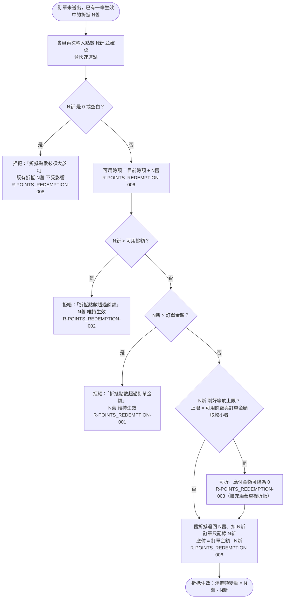

# 重複折抵以新換舊

訂單上已有生效中的折抵時再次折抵：先把舊折抵退回算出可用餘額，再做零值、餘額、訂單金額檢查，等於上限可折；通過則舊退新扣、訂單只留最新一筆；被拒絕時舊折抵維持生效。

涵蓋 rule_id：R-POINTS_REDEMPTION-006、R-POINTS_REDEMPTION-003（沿用 R-POINTS_REDEMPTION-001、R-POINTS_REDEMPTION-002、R-POINTS_REDEMPTION-008 的檢查）

## 白話複述

1. 訂單上已經有折抵又再折一次（含連點）→ 以新換舊：先把舊點數退回，用退回後的餘額做上限檢查，通過就扣新點數，訂單只留最新一筆。（R-POINTS_REDEMPTION-006）
2. 新點數剛好等於上限（退回後餘額或訂單金額取較小者）→ 可以折。（R-POINTS_REDEMPTION-003）
3. 新點數超過退回後餘額 → 拒絕「折抵點數超過餘額」；超過訂單金額 → 拒絕「折抵點數超過訂單金額」；0 或空白 → 拒絕「折抵點數必須大於 0」。三種拒絕都不改任何數值，因此舊折抵維持生效（R-POINTS_REDEMPTION-001／R-POINTS_REDEMPTION-002／R-POINTS_REDEMPTION-008 既有 post_assertions 的直接含意，使用者確認 spec-03 寫入 Then 即可，不改矩陣）。

## 已知取捨

- 不提供部分取消；要改點數一律走本流程以新換舊。（R-POINTS_REDEMPTION-004）

> 確認時間：2026-10-18 01:45
